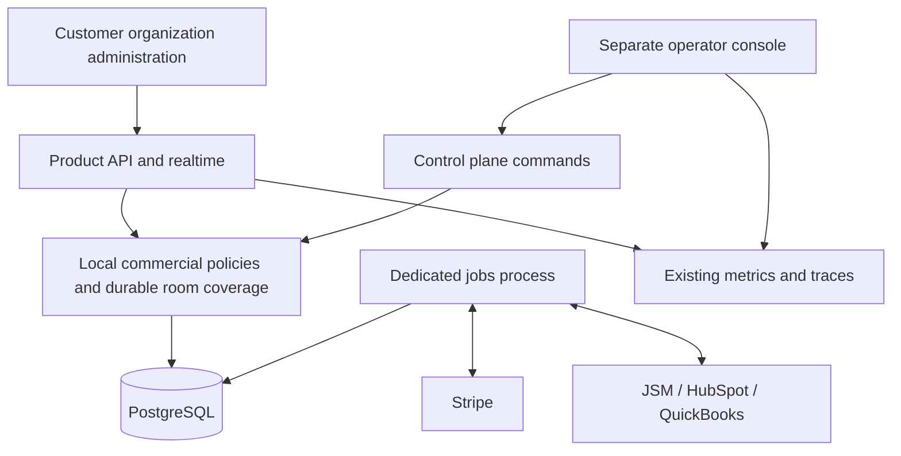

# Hosted business management

The business platform extends the existing modular monolith. PostgreSQL remains authoritative;
neither operator-console availability nor payment-provider availability authorizes live answers.
New hosted commercial writers are disabled by default. Community deployments retain their
existing access and billing behavior.



## Customer and commercial boundaries

An organization is the payer. A workspace remains the content and collaboration boundary.
Organization owners and administrators manage membership and workspaces; billing members can
manage purchases and licenses without gaining access to polls, reports, or another workspace's
content. Organization invitations require a signed-in identity with the matching verified email.

Migration 065 gives each existing workspace a separate organization. It preserves workspace,
provider-customer and subscription IDs rather than merging customers with a common human owner.
Organization-aware identity deletion preserves team data and commercial records. A last owner
must transfer ownership or explicitly close the organization first. Workspace transfer between
organizations is outside this release.

Subscriptions buy workspace licenses. Assignments cannot exceed purchased quantity; reassignment
requires the previous workspace's subscription-funded rooms to have finished or expired. Renewal
failure receives seven days from the recorded paid-through boundary, without extending grace on
each retry. An initial unpaid purchase receives no grace.

An organization shares its purchased and complimentary event credits across its workspaces.
Purchased credits do not expire or transfer between organizations. A credit funds one Round or
Presentation room with the initial Pro live/report profile. It does not raise ongoing library
publication or authoring budgets, or fund Surveys or separate practice rooms.

The hosting screen explicitly selects credit funding. Creating the room reserves one credit in
the same PostgreSQL transaction; the first durable audience admission consumes it in the same
transaction as participant persistence. A host, cohost, or Companion is not audience admission.
Joining anonymously for a test does count; use rehearsal instead when a credit should remain
unused. Reconnect, retry, and room deletion do not charge again or restore consumed credits.
Empty finished/expired rooms release reservations. The jobs process repairs expired reservations.

Room coverage freezes funding, capacity, live/report capabilities, and retention terms. A later
downgrade, license move, or ordinary operational pause does not reduce existing room benefits.
Security admission restrictions are explicit separate audited controls. Commercial records and
credit history survive content retention and room deletion. Support restorations append a
compensating credit linked to the original consumption.

Offers are versioned snapshots. Configure the catalog using `BUSINESS_CATALOG_JSON`; unpublished
offers cannot initiate checkout. See the catalog parser and its tests for subscription and pack
examples. Stripe prices, currency, amount and recurring interval must agree with a published
offer. Prices remain business configuration rather than hardcoded launch promises.

`BUSINESS_STRIPE_AUTOMATIC_TAX_ENABLED` defaults to `false`. When enabled, new organization
checkouts request Stripe automatic tax for both subscriptions and credit packs, collect a billing
address and optional business tax ID, and save the entered address/business name to an existing
Stripe Customer. New pack purchases create a Customer; subscription checkout creates one when
needed. This follows Stripe's [Checkout tax integration](https://docs.stripe.com/tax/checkout/page)
and [tax-ID collection](https://docs.stripe.com/tax/checkout/tax-ids) options. Stripe's customer
address hierarchy still applies, including previously saved shipping addresses.

Before enabling paid sales, review the merchant's Stripe Tax business settings, applicable active
registrations, product tax codes, price tax behavior, customer address data, and accounting
mapping. Rehearse tax-inclusive and tax-exclusive prices, business tax IDs, existing customers,
renewal invoices, discounts and refunds in Stripe test mode. This switch does not configure
registrations, determine tax obligations, or update existing subscriptions and open Checkout
Sessions; review those separately in Stripe before launch. Customer tax IDs and billing
addresses remain in Stripe rather than the webhook inbox or PollingPops audit records.

## Feature availability and plans

Open **Features** in the operator console to manage implemented product capabilities. **Features**
shows availability and plan assignments; **Plans** shows the same policy as a Free/Pro/Team matrix.
Choose **Enabled** or **Disabled** for a feature and select its included plans. **Inherit deployment**
returns that feature to its existing environment and workspace rollout configuration. Each feature
can be migrated independently; saving one setting does not change inherited settings elsewhere.

Explicit policy is authoritative for that feature's product flag and workspace allowlist. It takes
effect on subsequent server requests without an application restart. Prerequisite features must
also be available to the selected plan. For example, Surveys requires Feedback rooms and Audience
scopes. Session summaries can be enabled independently; creating links and downloading files also
requires **Report exports** for the effective plan.

**Brainstorming boards** is independent of Surveys and live Presentation availability. It adds
the **Idea boards** workspace entry and direct guest links. Its inherited deployment default uses
`FEATURE_IDEA_BOARDS` and the core-parity workspace allowlist; explicit availability and plan
assignments override both. Existing boards can still be read, closed and deleted when creation
is paused. Boards freeze the participant limit (capped at 250) and retention at creation.

Founder and operations staff can change policy; read-only staff can inspect it. Changes use the
existing review dialog, require a reason and recent authentication, and atomically save the policy,
audit event and retry receipt. Revision checks reject concurrent edits rather than overwrite a
newer policy. Reload the latest policy after a conflict and review the intended changes again.

Migration 072 stores the global policy in PostgreSQL. Community mode uses the Team assignment.
Event-funded new Round/Presentation rooms use Pro; retained room coverage keeps its recorded
benefits. Existing summaries, published records and active rooms keep their existing read/resume
paths when new creation is paused. Assignments change feature access, while numeric capacity,
retention, billing prices, provider credentials, storage/scanning setup and operational service
controls keep their existing configuration boundaries.

The redesigned console opens to **Overview**, with service activity cards and worker controls.
**Staff** has operator access management. Existing Organizations, Billing, Credits, Operations,
Support, Integrations and Audit areas retain their permission checks.

## Processes and operator access

Platform administrators open the standalone console directly. In the normal local bundles, run
`pnpm local:start`, then provision an account in an interactive terminal:

```bash
pnpm admin:setup --username admin --name "Platform admin" --role founder
```

Enter and confirm a hidden password, add the displayed TOTP secret or enrollment URI manually to
an authenticator app or compatible vault, then open <http://localhost:3002>. Sign in with the
username, password and current six-digit code. There is no default password, automatic account,
customer account prerequisite or email-based administrator provisioning. Use `--docker-context NAME`
and `--profile core|media|observability` when the running local bundle requires them.

Local startup reuses the ignored private `data/admin/credential.key` (file mode `0600`, directory
mode `0700`); an explicit `OPERATOR_CREDENTIAL_KEY` in the environment or `.env` takes precedence.
Only control receives the key. Back it up securely with the database because it encrypts the
authenticator secrets. `pnpm admin:setup` with `--reset` explicitly replaces password and
TOTP enrollment, revokes existing administrator sessions and preserves a disabled account's state.
Migration 073 adds isolated credential and login-throttle records. See the
[console setup guide](../apps/control/README.md#standalone-password-authentication) for native and
hosted provisioning details.

Customer headers, desktop/mobile workspace menus and account navigation retain organization
controls. Members see their organization; owners/admins see workspace, membership and settings
controls, while billing members see billing and event credits. Links select the organization that
grants the required permission. Direct visits to `/organization` ask signed-out users to sign in
and show an unavailable state when hosted management is disabled, including Community deployments.

Customer email-link sign-in always issues customer sessions using the configured product URLs.
It never creates, reuses, clears or revokes administrator credentials. Customer sign-out revokes
only the supplied customer session. Customer navigation neither discovers the console nor probes
its session; the compatible `operatorConsoleOrigin` response field is always `null`. Administrator
sessions do not authorize customer requests. Product pages and workspace menus have no business
administration entry. Staff use the console's own sidebar, and customer navigation/gameplay remains
independent of console availability.

- `apps/web` and the Fastify/realtime server continue serving customers.
- `apps/control` serves the separate operator UI and same-origin API.
- `node apps/server/dist/jobs.js` runs reports, authoring, retention, billing reconciliation and
  integrations without constructing gameplay or an HTTP application.
- The API keeps its audience outbox relays. Set `BACKGROUND_JOBS_MODE=separate` when a dedicated
  jobs process is running; the normal local service bundles include that process. The default
  `in_process` supports standalone product startup.

Control uses its own database URL. Password mode requires a persistent credential encryption key,
explicit offline provisioning and authenticator codes. Hosted control can alternatively use a
dedicated managed OIDC application; the hosted overlay defaults to that mode. Configure exact MFA
assurance claims, enforced provider policy and explicitly provisioned issuer/subject identities.
OIDC bootstrap creates missing accounts and does not reactivate disabled operators. Customer cookies,
customer institution OIDC roles and the legacy administrator bearer token do not authorize the
console. Operator sessions are revocable, expire absolutely, and have an idle timeout. Sensitive
commands require recent authentication. All commands include a reason and idempotency key;
effects, receipts, and attributable audits commit together.

The console provides organizations, billing, operations, support, integrations, and audit/access
views. Support cases, queue failures, stale heartbeat information and integration receipts retain
links to their source records. Deployments stay in the existing deployment workflows.

## Integrations

Connect named providers from the restricted console. Credentials are encrypted with the same
32-byte `INTEGRATION_SECRET_KEY` in control and jobs, and are never returned to the browser.
Provider hosts and request durations are bounded. The durable outbox tracks attempts, leases,
receipts and failures; uncertain support creation requires reconciliation rather than blindly
creating a second external request.

- **Jira Service Management:** create requests from explicitly triaged redacted support cases;
  store their issue/request references and read status. Customer correspondence remains in JSM.
- **HubSpot:** upsert companies keyed by the stable PollingPops organization property. Provision
  that approved unique property first. Explicitly designated verified customer contacts may be
  synchronized; participant identities and answers are excluded.
- **QuickBooks Online:** the native Stripe connector is the accounting writer where the chosen
  country edition supports it. PollingPops performs read-only reconciliation and exports credit
  consumption/outstanding balances. Otherwise use accountant-managed import. Do not enable a
  second sales writer or independent recurring charging for mirrored Stripe transactions.

Stripe webhooks are signature-verified and durably received before acknowledgement. Workers
retrieve authoritative provider objects, verify purchase mappings, and fulfill paid purchases
idempotently, including delayed payments. Browser success redirects do not grant access.

## Rollout and launch rehearsal

1. Deploy migration 065 and compatible readers with commercial writers disabled.
2. Provision standalone administrator credentials or the dedicated OIDC application, plus the
   reviewed network boundary and database principal. Verify founder access, MFA, revocation and role
   restrictions.
3. Configure reviewed offers and Stripe test-mode prices, then enable `BUSINESS_PLATFORM_ENABLED`.
4. Exercise workspace licenses, renewal failure/grace, cancellation, pack payment, discount,
   redemption, concurrent admission, empty expiry and compensating credits before enabling
   `BUSINESS_EVENT_CREDITS_ENABLED` publicly.
5. Connect the approved JSM, HubSpot and QuickBooks accounts. Rehearse revocation, rate limiting,
   uncertain delivery, accounting mismatch, and an outage while a room continues.
6. Prove independent paging and a clean off-host restore with the exact candidate. Configure
   tax/accounting mappings and distinct financial, operator, support and telemetry retention.

For local development, the normal service bundles merge `compose.business.yaml` and
`compose.local-control.yaml` after `compose.yaml`. The operator container binds only to loopback;
the local override selects standalone password/TOTP authentication with explicit development-only
loopback HTTP. Product control origins stay blank and customer authentication stays independent.
Using `compose.business.yaml` alone retains its optional, production-policy console configuration.
For hosted single-VM operation, merge `compose.single-vm.business.yaml` after the existing base;
it requires an immutable control image, dedicated hostname and reviewed operator-network CIDRs.
Its jobs container deliberately has no API ingress alias. Validate the merged configuration and
image signatures through the existing deployment review before deploying it.

Add the business Compose overlay to `singleVm.composeFiles` and both operator Caddy files to
`singleVm.deploymentFiles` in the reviewed staging/production target to opt in. The existing
product-build workflow then builds, scans and signs the control image. Deployment verifies all
manifest images and injects the immutable control reference alongside the product references;
the production acceptance record binds its digest, SBOM, provenance and scan evidence too.
Create a separate restricted `openround_control` login with membership in `openround_runtime`
and set its dedicated connection URL. The operator ingress removes authentication query values
from access logs using Caddy's [log filters](https://caddyserver.com/docs/caddyfile/directives/log).

Investigate `PollingPopsBusinessQueueDelayed` and delivery alerts in the Operations/Integrations
console views. An ambiguous JSM creation requires looking up the retained delivery reference
before retry; a failed job can be retried after fixing its cause. For missing jobs heartbeats,
inspect the jobs container and database connectivity before resuming paused queues. Expired
reservation alerts require confirming the room remained empty before the repair worker releases
the reservation. These projections contain no tenant labels; use organization search to inspect
individual records. Monitor the public product and private console from an independent uptime
service and route paging outside the product's own host as part of the launch rehearsal.

Writer rollback disables new commercial activity, not readers or consumption of already reserved
rooms. Keep the coverage, inbox/outbox and ledger readers until every retained resource has
expired. Passing local tests does not establish real payment acceptance, human paging, provider
residency, bookkeeping correctness, or off-host recovery evidence.

## Review and local acceptance

| Phase                  | Review surface                                                                            | Local acceptance                                                                                       |
| ---------------------- | ----------------------------------------------------------------------------------------- | ------------------------------------------------------------------------------------------------------ |
| Identity and tenancy   | Migration 065, platform repositories, user authentication and organization administration | Isolation, billing-only re-login, owner transfer/closure, identity deletion                            |
| Management foundation  | `apps/control`, operator authentication/commands, jobs entrypoint and restricted ingress  | MFA/session revocation, permission denial, audited retries, process-independent gameplay               |
| Subscription billing   | Catalog, platform billing routes and durable billing worker                               | Paid-only fulfillment, grace boundary, unordered events, delayed payment, authoritative reconciliation |
| Credits and promotions | Ledger/coverage hooks, creation and admission transactions, event-funding UI              | Concurrent reservations/joins, rollback, retry, expiry race, frozen report terms                       |
| Operational workflows  | Operations projections, worker controls and provider adapters                             | Failed-only recovery, ambiguous delivery, credential revocation, consent and accounting exceptions     |
| Launch rehearsal       | Business overlays and existing deployment/evidence workflows                              | Local browser journeys and alert rules; configured external rehearsals remain launch gates             |

Run `pnpm check` for formatting, dependency contexts, lint, types, unit checks and all production
builds. Run `pnpm --filter @openround/db test:postgres` with isolated restricted runtime/admin test
URLs for PostgreSQL conformance. `pnpm test:e2e:business` and `pnpm test:e2e:control` exercise customer
and operator workflows against explicit local test fixtures; CI runs both. `pnpm test:alerts`
verifies the existing and business alert thresholds. The operator acceptance fixture performs
signed local OIDC discovery/token verification rather than adding a production authentication
bypass.
