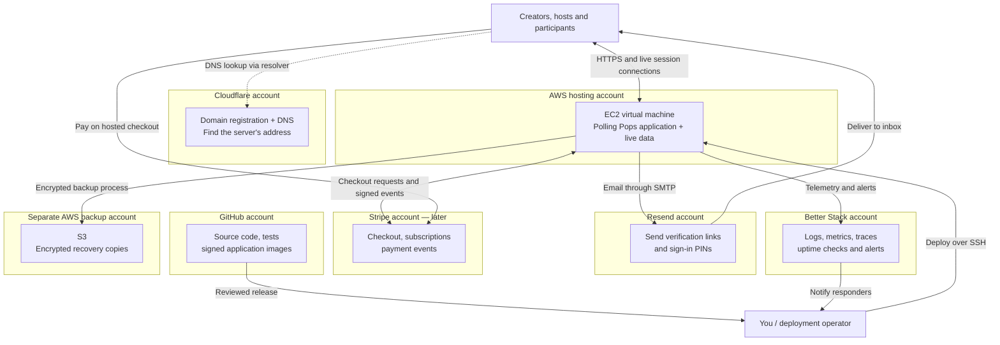
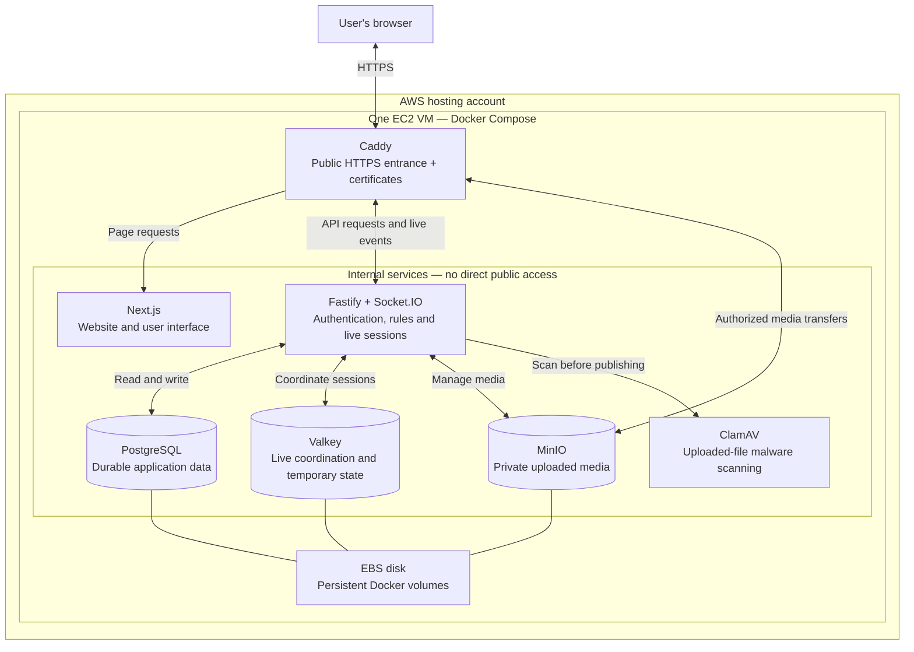
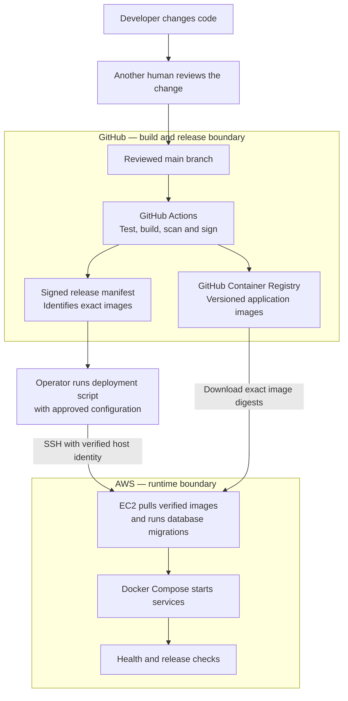
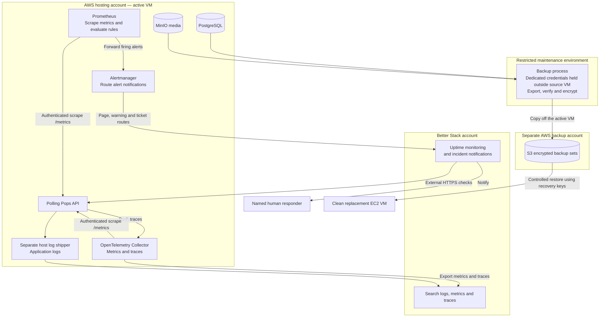

# Polling Pops deployment architecture guide

Polling Pops uses a **modular monolith deployed on one virtual machine**, supported by
external services. Its business features form one coordinated application, while separate
containers run the website, API, database and supporting tools.

This guide brings together the account checklist, provider boundaries and five diagrams for a
real deployment rehearsal. AWS EC2 is the selected staging provider in the repository. Cloudflare,
Resend, Better Stack and S3 in a separate backup account are the proposed supporting products.
These diagrams describe the intended connections; they do not establish that any account,
integration or environment has been provisioned.

Start with staging. Staging and production each need their own VM, credentials, database and live
media. They can use the same hosting provider account while remaining separate deployments.

## Contents

- [Products and architectural roles](#products-and-architectural-roles)
- [Account checklist in priority order](#account-checklist-in-priority-order)
- [1. Overall product and account boundaries](#1-overall-product-and-account-boundaries)
- [2. Inside the AWS virtual machine](#2-inside-the-aws-virtual-machine)
- [3. From code to a running deployment](#3-from-code-to-a-running-deployment)
- [4. Email authentication and payments](#4-email-authentication-and-payments)
- [5. Monitoring and disaster recovery](#5-monitoring-and-disaster-recovery)
- [Environment and access boundaries](#environment-and-access-boundaries)
- [Operational references](#operational-references)

## Products and architectural roles

| Product                              | Architectural role                  | What it provides                                                            |
| ------------------------------------ | ----------------------------------- | --------------------------------------------------------------------------- |
| GitHub and GitHub Container Registry | Development and delivery            | Source code, independent review, automated checks and signed release images |
| AWS EC2 and EBS                      | Hosting infrastructure              | A Linux virtual machine and persistent disk for the running application     |
| Cloudflare Registrar and DNS         | Domain and DNS                      | Domain ownership and lookup of the application's server address             |
| Resend                               | External email service              | Verification links and sign-in PIN delivery                                 |
| Better Stack                         | Observability and incident response | Logs, metrics, traces, external uptime checks and incident notifications    |
| Separate AWS account and S3          | Disaster recovery                   | Encrypted recovery copies outside the active server's account               |
| Stripe                               | External payment service            | Hosted checkout, subscriptions, billing portal and payment events           |

PostgreSQL, Valkey, MinIO, ClamAV and Caddy run in the Docker stack. They do not require separate
hosted-service accounts. The application is organized into presentation, application and data
layers, all deployed on the same VM for this topology.

## Account checklist in priority order

- [ ] **1. GitHub:** reuse the existing account with administration access to
      `riojung/pollingpops`. Arrange a second human collaborator with their own account and repository
      write access for independent review. Configure the protected staging environment before the
      first signed-image build.
- [ ] **2. AWS hosting:** create or reuse an account with billing enabled, MFA and a budget alert.
      Prepare EC2 and EBS access. The documented starting host is Linux **amd64**, with **4 vCPUs,
      8 GB RAM and 100 GB SSD**. Launch it when the required deployment inputs are ready.
- [ ] **3. Cloudflare Registrar and DNS:** create an account and register an available domain,
      or use an existing domain and DNS provider. One domain can provide separate application and media
      subdomains for staging and production. The diagrams below use Cloudflare in DNS-only mode.
- [ ] **4. Resend:** create an account, verify the sending domain through DNS and create a dedicated
      API key for SMTP. Prepare a test inbox for verification links and sign-in PINs.
- [ ] **5. Better Stack:** create one account for Telemetry and Uptime/Incidents. Configure the
      telemetry source, separate host log shipping, uptime checks and distinct page, warning and ticket
      alert integrations. The readiness observer adapters also need provider-specific configuration.
- [ ] **6. AWS backup account and S3:** create a separately administered backup account and a private
      bucket with encryption, versioning and retention. Keep backup credentials and recovery keys
      outside the active application VM. Configure scheduled backup jobs and a clean-host restore drill.
- [ ] **7. Stripe:** create an account when billing testing begins and use its test environment
      first. Stripe can wait for the initial billing-disabled staging deployment. The unchanged
      production configuration and release gates require a real Stripe test-mode billing rehearsal;
      complete merchant and bank setup before accepting live payments.

Items 1–6 supply the accounts for the staging deployment and recovery exercises. Account creation
must be followed by configuration, integration and verification. Public production promotion also
requires the existing [release-readiness gates](release-readiness.json).

## 1. Overall product and account boundaries

Each outer box represents a provider or account boundary. Solid arrows show application,
deployment or operational flows. The dotted arrow represents DNS lookup.

Cloudflare in **DNS-only mode** tells browsers where the server lives; browsers then connect
directly to AWS. Enabling Cloudflare's proxy would add Cloudflare to the web traffic path and
requires a separate reviewed ingress configuration. See
[Cloudflare proxy status](https://developers.cloudflare.com/dns/proxy-status/).

## 2. Inside the AWS virtual machine

EC2 is the rented computer. Docker Compose runs the components together on that computer.
Caddy is the public HTTPS entrance; the other services communicate over internal networks.

The three logical application layers are:

- **Presentation:** Next.js serves pages and the browser user interface.
- **Application:** Fastify owns authorization, business rules and API operations; Socket.IO
  carries live session updates.
- **Data:** PostgreSQL stores durable application records and MinIO stores private media.
  Valkey supports live coordination and is rebuildable.

PostgreSQL is the durable source of truth. The API authorizes media access and issues constrained,
short-lived upload or download URLs. Uploads enter MinIO quarantine; the server validates and
scans the content before promoting clean files.

Caddy routes the app hostname to Next.js and the API, and the separate media hostname to MinIO.
The public media route does not make the bucket anonymous. Database, cache, scanning, metrics and
administration endpoints remain private.

All these containers share one VM and disk failure domain. Losing that VM interrupts the service;
container restart policies do not provide failover. The minimum host size is a starting point
that requires capacity testing on the actual target.

## 3. From code to a running deployment

GitHub prepares the release. The operator initiates deployment to AWS using the reviewed release
manifest and configuration.

This is the **CI/CD architecture**. Continuous integration checks changes; the controlled
deployment process installs a reviewed release. GitHub Actions signs release images using its
approved identity. GitHub Container Registry stores those images, so no separate container-registry
provider account is needed.

The documented workflow uses the operator's deployment script over SSH. The diagram does not imply
that GitHub Actions automatically logs into the production server. Runtime database credentials
remain restricted; the one-shot migration receives separate elevated credentials.

Production adds the protected release-tag, signed-release and readiness acceptance requirements
in the [deployment runbook](runbooks/deployment.md).

## 4. Email authentication and payments

These are separate workflows. Both refer to the same Polling Pops API running on EC2.

```mermaid
flowchart TB
    subgraph Login["Creator sign-in flow"]
        L1["Creator requests a sign-in PIN"]
        L2["Polling Pops API creates PIN challenge"]
        L3["Resend delivers PIN email"]
        L4["Creator submits PIN to Polling Pops"]
        L5["API validates PIN<br/>and creates application session"]

        L1 --> L2 --> L3 --> L4 --> L5
    end

    subgraph Billing["Paid-plan flow — enabled later"]
        P1["Creator selects a paid plan"]
        P2["Polling Pops API creates Stripe checkout"]
        P3["Creator pays on Stripe"]
        P4["Stripe sends signed webhook<br/>to Polling Pops API"]
        P5["API verifies event<br/>and updates plan in PostgreSQL"]

        P1 --> P2 --> P3 --> P4 --> P5
    end
```

New creators first verify their email address through a separate verification link. Verification
establishes mailbox ownership; it does not sign them in. They then request a six-digit PIN to create
an application session. Participants can join sessions without creating accounts.

Resend delivers the messages through [SMTP](https://resend.com/docs/send-with-smtp); Polling Pops
owns identity verification, PIN validation and sessions. Domain verification records live in DNS.

Stripe owns checkout and payment processing; Polling Pops owns application permissions. Stripe
webhooks enter through Caddy. The API verifies their signatures and handles event identity and
ordering before changing entitlements. Returning to a browser success page does not itself grant
an upgrade. Billing can remain disabled during the initial staging exercise.

## 5. Monitoring and disaster recovery

Monitoring reports what is happening. Backups provide recoverable copies of durable data.

The API pushes traces to the private OpenTelemetry Collector. The collector and Prometheus each
initiate authenticated scrapes of the API's `/metrics` endpoint. The scrape arrows show request
initiation; metric responses travel back over those connections. Prometheus evaluates alert rules
and forwards firing alerts to Alertmanager, which routes page, warning and ticket notifications
to distinct receiver integrations. A separately managed host log shipper sends application logs;
the supplied telemetry overlay does not collect Docker logs itself. Better Stack also checks the
public HTTPS endpoint from outside the VM.

Better Stack supports the required [OpenTelemetry ingestion](https://betterstack.com/docs/logs/open-telemetry/)
and [Alertmanager webhooks](https://betterstack.com/docs/uptime/prometheus/). Configuring these
connections, log shipping, readiness observers and named responders remains deployment work.

MinIO serves **live media**. S3 holds **backup copies** of the PostgreSQL export and media,
including the metadata and tags required for recovery. Backups must be encrypted, verified and
retained outside the active VM; recovery keys must remain available outside it as well.
The backup process runs from a restricted maintenance environment using dedicated source-read
identities and a separate destination-write identity. Backup credentials stay outside the source
VM and the backup payload; source access uses approved restricted connections.
[S3 versioning](https://docs.aws.amazon.com/AmazonS3/latest/userguide/Versioning.html) helps retain
previous object versions, but a successful clean-host restore is the recovery exercise.

The replacement VM is a restore target, not an automatically running standby. The current
single-VM topology does not provide automatic failover or a high-availability guarantee.

## Environment and access boundaries

| Boundary                               | Rule                                                                                     |
| -------------------------------------- | ---------------------------------------------------------------------------------------- |
| Staging and production                 | Separate VMs, credentials, databases, media and Compose projects                         |
| Internet and application               | Public web and media requests enter through Caddy; operator SSH is restricted            |
| Application and database               | The long-running application uses a restricted role; migrations use separate credentials |
| Public media route and private storage | Short-lived authorized transfers; quarantine and scanning before publication             |
| Hosting and backup accounts            | Separate administration and credentials, with encrypted off-host copies                  |
| Application and external providers     | Dedicated credentials for email, telemetry, alerts and payments                          |
| Operator and independent reviewer      | A second human reviews the protected release path                                        |

## Operational references

- [Architecture and protocol](architecture.md)
- [Single-VM hosting profile](../infra/single-vm/README.md)
- [Beta release preparation](runbooks/beta-release-preparation.md)
- [Build, service and deployment runbook](runbooks/deployment.md)
- [Staging readiness and observer configuration](runbooks/staging-readiness.md)
- [Repository governance](runbooks/repository-governance.md)
- [Backup and restore](runbooks/backup-restore.md)
- [API reference including billing](api.md)
- [Production deployment configuration](../config/deploy/production.json)
- [Release-readiness ledger](release-readiness.json)
