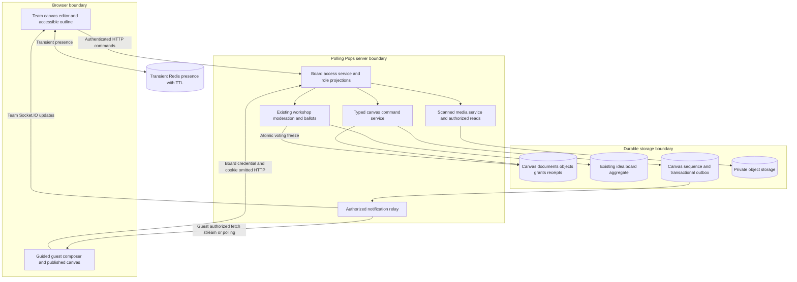

# Idea Board canvas analysis and implementation plan

Updated: October 29, 2026

Source baseline: `e1d86c48639cb5fba904351efe657abaec5f7856`

Status: Orders 0–4 implemented as an opt-in pilot; orders 5–7 remain planned

Idea Boards should become a shared spatial workspace for team members and a guided workshop
experience for accountless guests. The first customer release should support both, as selected
by the product owner. A canvas toolbar alone will not deliver that experience: board sharing,
object storage, concurrent editing, and permission-aware synchronization are prerequisites.

Preserve the existing brainstorming workflow and its privacy protections. Build a separate typed
canvas document around them instead of enlarging the existing sketch attachment. Use Miro's
manual canvas capabilities as a benchmark for interaction quality while retaining Polling Pops'
own design, content, and assets. AI generation, assistants, automatic clustering, recognition,
and AI summaries are outside this plan.

## Implementation status

The first release implements board-scoped same-organization sharing, a versioned normalized
canvas repository and migration 079, typed object editing, actor-scoped undo/redo, live team
updates and optional presence, plus a published guest canvas around the original moderated
workshop workflow. The [architecture decision](decisions/002-idea-board-canvas.md) records the
original SVG/DOM renderer and its limits. This document's baseline analysis below describes
the pre-implementation code; the later productivity scope in orders 5–7 remains deferred.

Memory and restricted PostgreSQL conformance, real two-node HTTP streams, legacy workshop
regressions and desktop/mobile browser journeys cover the functional boundaries. The opt-in
capacity harness is `tests/load/canvas-load.mts`. On a local PostgreSQL 17 instance on October
29, 2026, 500 objects and 20 licensed editors committing 200 independent updates passed
correctness, RLS, durable retry and revocation checks. Durable acknowledgement measured
469.73ms p50 / 820.68ms p95 / 1012.84ms max; concurrent snapshot reads measured 101.17ms p50 /
164.13ms p95. These repository timings are not commit-to-peer or browser rendering measurements.
The proposed latency, frame-rate and named-device budgets below remain pilot validation gates;
this implementation does not establish a production capacity guarantee.

Hard pilot bounds are 100 retained canvases per workspace, 500 objects and 2 MiB per document,
5,000 accepted mutation receipts per document lifetime and 4 MiB of bounded inverse history.
Workshop canvases reserve 200 object slots for source ideas. No AI features, unrestricted
offline editing or character-level text coauthoring are introduced.

## Baseline capabilities and gaps

The current implementation is a moderated idea collection and prioritization system. Its
strengths are useful foundations rather than features to replace.

| Area          | Current implementation                                                                                                      | Enhancement needed                                                                                |
| ------------- | --------------------------------------------------------------------------------------------------------------------------- | ------------------------------------------------------------------------------------------------- |
| Board library | Paginated board list and a complete creation form with identity, moderation, visibility, vote budget, and collection window | Search, thumbnails, templates, recent boards, Shared with me, and a shorter creation flow         |
| Ideas         | Text with scanned images, links, and an optional sketch; private pending submissions                                        | Direct team-authored canvas objects and clear separation from moderated guest submissions         |
| Organization  | Approved idea cards rendered in grouped lists; manual group assignment                                                      | Board coordinates, drag arrangement, selection, frames, alignment, and connectors                 |
| Drawing       | Local SVG sketch editor with shapes, pen, text, pointer/keyboard controls, undo and redo                                    | Shared board editing; the existing sketch is only one idea's attachment                           |
| Collaboration | Full host and guest projections fetched approximately every five seconds; retry and revision safeguards                     | Live updates, object conflicts, connection state, presence, and actor-scoped undo                 |
| Facilitation  | Collection, moderation, grouping, visibility, final ballots, closure, deadlines, and retention                              | Controls integrated into the canvas, then timer, frame navigation, comments, and presenter follow |
| Accessibility | Native forms and voting controls; sketch element list and inspector; responsive layouts                                     | Equivalent keyboard and screen-reader workflows for the shared canvas, plus touch navigation      |

Evidence: [board library](../apps/web/components/idea-boards/board-library.tsx#L149),
[grouped idea rendering](../apps/web/components/idea-boards/idea-list.tsx#L23),
[host polling](../apps/web/components/idea-boards/board-host.tsx#L98),
[guest polling](../apps/web/components/idea-boards/board-guest.tsx#L61), and
[sketch bounds](../apps/web/components/idea-boards/sketch-model.ts#L3).

The screenshot shows the library and creation surface, not the entire existing feature set.
Its large configuration form should become a compact entry flow, with workshop policies in
clearly labelled settings. A disabled create button with an empty required title is not itself
evidence of a defect.

### Existing constraints that affect the architecture

- The board aggregate is one JSONB document, bounded to 1 MiB, 200 ideas, 20 groups, 250 admitted
  guests, and 5,000 receipts. Plan limits can reduce guest capacity. Current transactions lock
  the board, and creator transactions also lock its workspace. Pointer traffic and frequent
  per-client snapshot reads should not use that same hot path.
- Sketches are limited to 1,000 by 600 coordinates, 32 elements, 1,024 total pen points, and
  16 KiB. Those limits describe an attachment format, not a canvas engine.
- Anonymous or alias identity, moderation, deadlines, and voting budgets are fixed at creation.
  Voting freezes submissions and grouping; closure is terminal. Repository transactions and
  database guards enforce these boundaries.
- The board revision is not a universal event cursor. Guest admission, upload reservations,
  and ballot revisions do not all advance it. Canvas synchronization needs its own sequence.
- New organization accounts give each licensed creator a separate organization-owned workspace.
  Organization membership or billing access does not grant access to another person's content.

Sources: [board SQL constraints and lifecycle](../packages/db/migrations/074_idea_boards.sql#L2),
[repository locking](../packages/db/src/idea-boards.ts#L845),
[typed idea contracts](../packages/contracts/src/idea-boards.ts#L3), and
[organization ownership and licenses](business-management.md#customer-and-commercial-boundaries).

## Manual canvas capability benchmark

These capabilities establish an interaction benchmark, not a promise of complete Miro parity.

| Capability                                                 | Relevant official reference                                                                                                                                                                                                                   | Polling Pops priority                                                                      |
| ---------------------------------------------------------- | --------------------------------------------------------------------------------------------------------------------------------------------------------------------------------------------------------------------------------------------- | ------------------------------------------------------------------------------------------ |
| Pan, zoom, touch and trackpad navigation                   | [Miro navigation](https://help.miro.com/hc/en-us/articles/360017731053-Using-Miro-with-a-mouse-trackpad-or-touchscreen)                                                                                                                       | First release: hand/select modes, pinch/wheel zoom, fit board and fit selection            |
| Sticky notes, text, shapes, drawing and frames             | [Miro tools](https://help.miro.com/hc/en-us/articles/360017730553-Toolbars)                                                                                                                                                                   | Start with notes, text, shapes and simple connectors; expand drawing and media tools next  |
| Select, move, resize, duplicate, group and arrange objects | [Miro objects](https://help.miro.com/hc/en-us/articles/360017730953-Working-with-objects), [content layout](https://help.miro.com/hc/en-us/articles/360017730973-Structuring-board-content)                                                   | Basic selection and actor-scoped undo first; bulk layout, locking and grouping next        |
| Named regions and navigation between them                  | [Miro frames](https://help.miro.com/hc/en-us/articles/360018261813-Frames)                                                                                                                                                                    | Simple frames and an outline before nested frames or presentation features                 |
| Discussion attached to objects                             | [Miro comments](https://help.miro.com/hc/en-us/articles/360017730873-Comments)                                                                                                                                                                | Team comment threads after reliable canvas permissions and synchronization                 |
| Guided attention, voting and timing                        | [Attention management](https://help.miro.com/hc/en-us/articles/360013358479-Attention-management), [voting](https://help.miro.com/hc/en-us/articles/360017572274-Voting), [timer](https://help.miro.com/hc/en-us/articles/360017730933-Timer) | Preserve existing ballots first; then add an optional timer and escapable presenter follow |
| Keyboard and assistive technology access                   | [Miro accessibility](https://help.miro.com/hc/en-us/articles/19506114302354-Overview-of-Miro-Accessibility)                                                                                                                                   | A first-release requirement, including a usable object outline and non-drag controls       |
| Export and mobile capability boundaries                    | [Miro export](https://help.miro.com/hc/en-us/articles/360017572754-How-to-export-your-board), [mobile capabilities](https://help.miro.com/hc/en-us/articles/360017572834-Mobile-app)                                                          | Specify and test our own mobile and export scope rather than assuming desktop parity       |

## Product experience

### Two board types with a common canvas

| Type            | Primary users                                              | Editing and lifecycle                                                                                                                                                            |
| --------------- | ---------------------------------------------------------- | -------------------------------------------------------------------------------------------------------------------------------------------------------------------------------- |
| Team canvas     | Invited, authenticated team members                        | Coauthor ordinary team objects. Use a document lifecycle such as active and archived, with an explicit plan retention policy. Guest participation is off in the first scope.     |
| Guided workshop | Facilitators, invited team editors, and accountless guests | Keep draft → collecting → voting → closed. Guests submit through a focused composer and see the permitted published canvas/list. Freeze workshop canvas changes at voting start. |

Choose the type at creation and make its consequences visible. Avoid switching a board's privacy
and lifecycle in place. A future team-canvas-to-workshop action should create a separate workshop
with a defined snapshot, rather than reinterpret an active document or a completed ballot.

Team canvases need a separate retention policy from a workshop's 1–30 day collection window.
Recommend keeping active team documents available while the owning account's policy permits,
with explicit storage limits and an archive policy. Final durations and quotas must be set before
the customer pilot; existing workshop deadlines and retention remain unchanged.

### Library and creation

Replace the permanent two-column list/form layout with a board library:

The pilot starts with blank boards, owned/shared discovery, and search. Templates and richer
thumbnails are later productivity increments in order 5; the steps below describe the target flow.

1. Show Recent, Owned, Shared with me, and Archived views, with search, status/type filters, and
   accessible grid/list choices. A thumbnail contains only content that viewer may access.
2. Create board opens a short flow: board type, title, and blank/template choice. Start with
   original brainstorming, retrospective, affinity grouping, impact/effort, and planning patterns.
3. A workshop setup panel explains who can join, whether ideas need review, when ideas become
   visible, the vote budget, and the collection deadline. Anonymous identity and moderation remain
   safe defaults. Explain immutable choices before creation.
4. Show owner organization/workspace, the visitor's board role, save/connection state, and
   retention information where relevant. Sharing a board never changes the active workspace.

### Team canvas workspace

```text
Back  Board title  Owning organization/workspace  Your role  Saved     Share
Select  Hand  Note  Text  Shape  Connector       Collaborators
┌──────────┬──────────────────────────────────────┬─────────────────┐
│ Tools    │                                      │ Inspector      │
│          │            Shared canvas             │ Object outline  │
│          │                                      │ Moderation*     │
└──────────┴──────────────────────────────────────┴─────────────────┘
Undo  Redo       Fit board  Zoom − / +             Connection status
* Workshop facilitator only
```

Use the full available workspace height and the existing collapsible global navigation. Keep
toolbars compact and open contextual controls in drawers. Support keyboard shortcuts only when
the user is not typing in a field. Preserve normal browser zoom and platform clipboard commands.

For phones and tablets, use compact top controls and bottom sheets for tools, outline and
inspection. Pan should be the safe default; drawing requires an explicit tool selection. Provide
pinch zoom, reliable two-finger navigation, 44px touch targets, and a list alternative at 320px.
Test real pen/touch input and CJK text composition, not just mouse emulation and static markup.

### Guided guest journey

```mermaid
flowchart LR
  Join[Join with board link] --> Draft[Compose private idea]
  Draft --> Submit[Submit once with retry receipt]
  Submit --> Review[Facilitator reviews privately]
  Review --> Publish[Publish approved idea card]
  Publish --> View[Guest views permitted canvas or list]
  View --> Freeze[Freeze voting snapshot]
  Freeze --> Vote[Submit final ballot]
  Vote --> Close[Close and reveal totals]
```



Keep Add idea, My submissions, Published ideas, Vote, and Results prominent. Guests should not
need the full editor toolbar. Their drafts remain private; submitted text remains protected
against silent rewriting. An approved idea appears as an `idea_ref` card linked to the original
submission, rather than becoming an ordinary editable sticky note. In the first scope, only a
facilitator changes approved guest-card placement and semantic grouping.

## Sharing and permissions

Board sharing is the first backend prerequisite. Existing workspace invitations are deliberately
unavailable for user-license organizations; inviting a teammate to an entire workspace would
undo the separate-workspace model. See [workspace invitation protection](../apps/server/src/auth.ts#L163).

Introduce explicit board grants to verified users in the same organization initially. Include
invitation acceptance, expiry, revocation, and Shared with me discovery. Defer cross-organization
sharing until its ownership, licensing, and retention rules are selected.

| Principal                                | Team objects                 | Workshop guest submissions                                                              | Administration                                                 |
| ---------------------------------------- | ---------------------------- | --------------------------------------------------------------------------------------- | -------------------------------------------------------------- |
| Board owner or authorized steward        | Edit                         | Facilitate when assigned                                                                | Share, assign roles, archive/delete within ownership policy    |
| Facilitator                              | Edit                         | Review pending ideas, publish/remove, arrange approved cards, manage groups and phases  | No automatic ownership or billing authority                    |
| Canvas editor                            | Edit authorized team objects | Read published ideas; no pending review or guest-card rearrangement                     | No sharing or phase control by default                         |
| Viewer                                   | Read permitted content       | Read the permitted published view                                                       | No editing or implicit commenting                              |
| Guided guest                             | No general team editing      | Submit bounded ideas, read own pending ideas, read published ideas, submit final ballot | No creator license required; existing admission rules apply    |
| Uninvited organization or billing member | No access                    | No access                                                                               | Organization/billing membership alone grants no content access |

Editing must honor current creator-license requirements where the organization uses user seats.
Validate membership, seat state, workspace restrictions, and the board grant on the server.
An explicit Viewer grant may let a billing-only member read that one board; their billing role
alone grants nothing. Editing requires an eligible creator role and license as well as a board
grant. A board invitation never allocates or bypasses a creator license.
The originating workspace/organization remains the owner and supplies policy, media ownership,
branding, quotas, and retention. A recipient's selected workspace must not replace those values.

Authenticate a shared-board user independently of active workspace selection, then authorize the
specific board. Return board-scoped capabilities to the UI; being owner of one's own workspace
does not make a user owner of a colleague's board. Use narrowly scoped repository authorization
and RLS for the owning board, never broad workspace membership or `app.system_access` as a shortcut.

Seat release, member removal, suspension, grant removal, and account deletion must invalidate
writes and live subscriptions across nodes. Preserve organization-owned content when an individual
leaves. Organization administrators may administer policy and audited stewardship without receiving
automatic access to all board content. This extends the existing
[organization access rules](business-management.md#customer-and-commercial-boundaries).

## Recommended architecture

Use server-authoritative canvas operations with optimistic local interaction. Persist accepted
changes before acknowledging them, and use a dedicated synchronization sequence. This supports
concurrent editing of different objects while keeping permissions, moderation and lifecycle rules
enforceable. Revisit character-level CRDT editing only after a demonstrated need and a separate
deletion, history, and authorization design.



### Canvas document and storage

Add a separate canvas domain; keep version 1 Idea Board and sketch contracts compatible.
The HTTP `/v1` prefix does not determine a stored document's schema version.

- **Document:** stable ID, owning workspace/organization, board type, lifecycle, schema version,
  canvas sequence, and optional link to an existing workshop aggregate.
- **Object:** stable ID, type, version, finite coordinates, dimensions, stacking order, bounded
  styles, visibility, and typed content. Initial types: sticky/text, basic shape, connector and
  approved `idea_ref`; add stroke, frame, team image and link types in later increments.
- **Relationships:** geometric groups/frames are separate from the existing idea `groupId`,
  which describes a semantic category. Validate cycles, missing parents, connector anchors,
  and deleted endpoints. Invisible endpoints must not leak private object IDs or text.
- **Grants and receipts:** board-scoped user roles, accepted operation IDs/fingerprints, and
  the current safe acknowledgement. Do not place guest credentials or ballots in canvas objects.
- **Snapshots and outbox:** bounded materialized state plus durable change notifications,
  with explicit pruning and redaction rules.

Use normalized tables scoped by owning workspace and board, with forced RLS and cascading
lifecycle cleanup. Avoid adding a frequently rewritten scene blob to the legacy 1 MiB aggregate.
Private intake remains outside the published scene. Pending objects must not be sent to guests
and hidden with CSS, coordinates, a collapsed frame, or the minimap.

Ordinary workshop notes, shapes and instructions default to `team_only`. Only a facilitator can
deliberately publish them into the guest-visible scene. Connectors, frames, outline entries,
thumbnails and exports inherit that visibility policy; publishing a frame does not automatically
publish private children. The voting freeze covers every published object and its relationships.

### Commands and concurrent edits

Each command carries a protocol version, operation ID, target object IDs, expected object
versions, and a bounded payload. Derive the actor and capabilities from authenticated access.

1. Authorize the actor and current board lifecycle; validate quota and operation shape.
2. Lock affected records in a stable order and recheck membership, license, board grant, lifecycle
   and object versions inside the committing transaction. Use an access-version fence or locks
   shared with revocation so authorization cannot become stale while waiting for locks.
3. Commit objects, receipt, new canvas sequence, and outbox metadata together.
4. Acknowledge after commit. An exact retry returns the original operation outcome and a current
   safe projection; a mismatched retry fingerprint fails.
5. Notify permitted readers. Reconnect uses a supported sequence range or a fresh authorized
   snapshot when history has been pruned or visibility has changed.

Different-object edits can succeed concurrently. Same-object conflicts must preserve the local
proposal and show a recoverable conflict rather than silently overwrite text. Start with an
editing indicator/short lease and optimistic version checks for text. Concurrent character-level
coauthoring is a later capability, not an implicit promise of the first release.

Undo and redo create authorized inverse operations for that actor. They must not rewind another
person's edits, resurrect removed guest content, bypass a new role, or alter frozen voting
evidence. Treat a drag as one undoable action; pointer previews are transient and the final
position is a bounded committed operation.

### Live updates and connection recovery

Reuse the existing [Socket.IO and Redis Streams infrastructure](../apps/server/src/realtime.ts#L134)
with a separate board event family and authorization. Reuse the outbox pattern from
[scoped audience delivery](../apps/server/src/scoped-audience-outbox-worker.ts#L4), not Round or
Presentation gameplay contracts.

For the first scope, use metadata-only notifications followed by current authorized object
reads; batch requests and coalesce changes. Add filtered deltas only after removal and replay
tests prove they cannot deliver stale private content. Do not fetch a whole board separately for
every socket or persist cursor updates under workspace-wide locks.

Keep selections, cursors and viewports ephemeral with TTL, rate limits, and opt-out controls.
Initially expose named presence to authorized team members. Anonymous guest mode must not gain
nicknames, stable public identifiers, or a participant directory through the presence feature.
Admitted guest count is not an online-presence count.

Browser WebSockets do not offer the same `credentials: "omit"` control as guest HTTP fetches.
Use team sockets for authenticated collaborators. Keep guest writes on the current cookie-omitted
HTTP path; use an authorized `fetch` stream with cookie omission for live invalidations and retain
polling as fallback. Do not assume native EventSource or a same-origin WebSocket preserves that
promise. A guest WebSocket can be considered after a cookie-less audience host and cookie-scope
configuration are proven.

HTTP fetch streams need their own per-node connection registry and shared metadata fanout;
the Socket.IO Redis adapter does not distribute notifications to those HTTP connections.
Every serving node must receive the relevant notifications, using independent replay cursors
or shared fanout with durable sequence-based recovery. A single outbox consumer group shared
by all stream nodes is insufficient. Specify heartbeat and cancellation handling, bounded
per-connection queues, backpressure/slow-client disconnection, connection quotas, and snapshot
recovery. Enforce idle expiry and revocation even when no further user operation occurs.

Reauthorize snapshots, object reads, replay, assets, and delivery. Revocation must work across
nodes, not just on the next page load. Show Saved, Saving, Reconnecting, Offline, and Conflict
states accurately. The first release promises online editing with recovery from interrupted
requests, not unrestricted offline coauthoring or automatic storage of guest text on disk.

### Workshop integrity and media

At voting start, freeze the workshop scene and its approved idea/group set in the same
transaction. Record the canvas sequence and a ballot-presentation snapshot. Moving a card,
changing a connector or frame, or rewriting surrounding instructions can change ballot meaning
even if the idea IDs stay fixed. Legacy phase commands must also enforce this freeze when a
canvas is attached; it cannot depend only on a new UI button.

Current guest images have strict board-and-guest provenance. Team uploads need an explicit user
principal and board ownership path, not a fake guest record or a generic media URL. Preserve
quarantine/scanning, image descriptions, private byte delivery, post-read access checks, and
quota enforcement. Never load arbitrary HTML, scripts, remote social embeds, or automatically
fetched link previews into the canvas. See [rich-board media safeguards](../packages/db/migrations/076_rich_idea_boards.sql#L25).

Removal and expiry apply to live state, operation payloads, undo, snapshots, thumbnails, exports,
and queued notifications. A historical revision must not recover removed moderated content.
Revalidate after asynchronous storage/database waits. Previously downloaded content cannot be
recalled, so export and clipboard actions need explicit content visibility rules.

## Canvas engine decision

Keep Polling Pops' domain model and permissions independent from the rendering library. Run a
short SDK integration spike before committing to an engine. Prefer adapting an established editor
where it supports our protected idea cards and accessibility requirements without a long-lived fork.

| Approach                              | Useful capabilities                                                                | Decision constraint                                                                                                                                                                                                                                                                                                                                                |
| ------------------------------------- | ---------------------------------------------------------------------------------- | ------------------------------------------------------------------------------------------------------------------------------------------------------------------------------------------------------------------------------------------------------------------------------------------------------------------------------------------------------------------ |
| Excalidraw embedded package           | Manual drawing, shapes, arrows, images, navigation, history and export foundations | [MIT license](https://github.com/excalidraw/excalidraw/blob/master/LICENSE). The embedded package does not supply the hosted app's collaboration; custom protected idea-card behavior needs proof. [Official integration](https://docs.excalidraw.com/docs/@excalidraw/excalidraw/integration), [FAQ](https://docs.excalidraw.com/docs/@excalidraw/excalidraw/faq) |
| tldraw SDK                            | Extensible shapes, editor interactions, accessibility support and a sync package   | Source available; production requires an applicable license key. Validate hosted and community/self-host deployment terms before selection. [Official license](https://tldraw.dev/community/license), [shapes](https://tldraw.dev/docs/shapes), [sync](https://tldraw.dev/docs/sync)                                                                               |
| Custom editor using Konva/react-konva | Control over domain-specific cards and interactions                                | [Konva is MIT](https://github.com/konvajs/konva/blob/master/LICENSE), but selection policy, history, text editing, collaboration and accessible DOM controls remain our workload. [Official overview](https://konvajs.org/docs/), [text editing](https://konvajs.org/docs/sandbox/Editable_Text.html)                                                              |

Start the permissive-license spike with Excalidraw, compare tldraw if its licensing fits the
distribution model, and retain Konva as a controlled fallback. This is a candidate order, not a
dependency selection. No library should be added until it passes the following shared scenarios:

- Render a protected, accessible guest idea card beside freely editable team notes.
- Round-trip stable typed IDs, positions and connectors without storing arbitrary SDK payloads.
- Apply remote changes and reject unauthorized edits without losing another person's work.
- Route images through our scanned, authorized media service.
- Provide actor-scoped undo, keyboard/list editing, CJK input, touch pan/zoom and acceptable
  performance at the proposed pilot budget.

SDK synchronization is not a substitute for our authorization, persistence, moderation, or
retention design. Record the selected engine, license obligations and benchmark results in an ADR.

## Implementation order

Sizes describe relative engineering complexity, not calendar commitments. A canvas/frontend
engineer and a backend/realtime engineer can work in parallel after shared contracts and access
rules are agreed, with design and QA involved from the first slice.

| Order | Deliverable and likely code areas                                                                                                                                                                     | Completion gate                                                                                                                    | Size |
| ----- | ----------------------------------------------------------------------------------------------------------------------------------------------------------------------------------------------------- | ---------------------------------------------------------------------------------------------------------------------------------- | ---- |
| 0     | Interaction prototype, engine/license spike, role/lifecycle ADR and quota policy; original canvas and guest wireframes                                                                                | Both user journeys demonstrated; engine handles protected cards; ownership, retention, and transport decisions recorded            | M    |
| 1     | Board grants and invitations, same-organization access service, board capabilities and Shared with me; auth/platform repositories, new board ACL storage, board library                               | Two licensed users in separate workspaces share one board without access to unrelated workspace content; revoke access while open  | L    |
| 2     | Versioned canvas contracts, normalized repository, receipts/sequences/outbox, explicit legacy adapter; contracts, DB migrations and server canvas service                                             | Concurrent different-object commands, exact retries, lifecycle fencing, memory/PostgreSQL conformance and unchanged legacy clients | L    |
| 3     | Canvas shell, note/text/shape/simple connector tools, selection, move/resize, fit/zoom, duplicate/delete, actor-scoped undo, accessible outline and inspector; new canvas components and board routes | Complete manual editing journey with persistent positions, keyboard alternatives, text composition and touch navigation            | L    |
| 4     | Team realtime, connection recovery, presence, guided guest canvas/list, moderation drawer, published idea references and atomic voting freeze                                                         | First customer pilot: both requested experiences work together; cross-node revocation, reconnect, privacy and ballot tests pass    | XL   |
| 5     | Frames, multiselect/bulk layout, geometric groups, locking, richer drawing, team image/link assets and original workshop templates                                                                    | Productive workshop creation and arrangement; quota/media cleanup and mobile controls verified                                     | L    |
| 6     | Anchored comments, timer, optional presenter follow, permission-safe region exports and bounded version history                                                                                       | Async discussion and facilitation work without exposing pending content or restoring removed data                                  | L    |
| 7     | Higher object/editor caps, richer manual diagrams and optional snapshot links to Rounds/Presentations                                                                                                 | Target-load evidence and explicit integration/privacy contracts before raising limits or linking artifacts                         | L    |

Orders 1–4 form the first customer release. An internal single-editor prototype at order 3 is
useful engineering progress but does not satisfy the collaborative product promise. Accessibility,
localization, permission checks and failure states belong in every order, not a final cleanup pass.

The first release includes a real shared canvas, board-level sharing, basic live collaboration,
guided guest intake, moderation, voting integrity, persistence and recovery. It does not require
nested frames, character-level text CRDTs, full offline editing, arbitrary file embeds, audio/video,
external integrations, or full presentation/diagramming parity.

## Migration and rollout

1. Add compatible readers, new tables and separate canvas contracts before enabling writers.
   Keep current host/guest URLs, board IDs, identity settings, deadlines, ballots and image
   provenance valid.
2. Existing boards open in their current list experience by default. Offer facilitators of eligible
   `draft` or `collecting` boards an explicit canvas upgrade with deterministic initial positions
   and the list as an alternate view. Check eligibility transactionally. Boards already `voting`
   receive only a deterministic read-only layout. Do not automatically rewrite idea bodies or sketches.
3. Keep closed legacy boards read-only; do not reinterpret terminal closure as a reversible archive.
   A read-only spatial layout can be computed from safe content. Copying a board must create new
   IDs and separately authorized media ownership, and must exclude pending material, credentials
   and individual ballots. Defer copying rich assets until that safe cloning path exists.
4. Introduce independent capability flags for canvas creation, sharing and realtime. Pausing new
   creation must preserve authorized existing reads and required lifecycle controls. A realtime
   outage exposes degraded status and a safe refresh/polling path.
5. Pilot with a small organization and a facilitated guest workshop. Expand only after acceptance
   gates pass. Keep readers for every accepted new schema during rollback; a legacy client must
   not overwrite a newer canvas it cannot represent.
6. Extend deletion, retention, account export, organization stewardship and media cleanup to all
   new rows and derived data before customer enablement.

## Acceptance and performance gates

### Required customer scenarios

- **Sharing:** A licensed teammate in another workspace accepts a board-only invitation, edits
  one note, and cannot read unrelated content. Uninvited billing-only members and cross-organization
  users are denied. An explicitly invited billing-only Viewer can read that board but cannot edit,
  moderate or gain access to its owning workspace.
- **Coauthoring:** Two editors change different objects concurrently. A lost acknowledgement can
  be retried exactly once logically. Same-object edits preserve both users' work for resolution.
  Undo cannot undo somebody else's operation.
- **Guest privacy:** An anonymous guest submits a rich idea. Only that guest and moderators see
  it pending; authorized publication makes its card visible. Canvas editors do not acquire pending
  moderation access. Private items never enter guest events, search, minimaps or thumbnails.
- **Object permissions:** A Canvas editor can edit team text but cannot move or regroup a guest
  idea card. A facilitator can arrange approved guest cards during collection. Both are denied
  workshop scene edits after voting freezes it. Publishing a frame does not expose private children.
- **Voting:** Starting voting and a simultaneous move/edit cannot change the frozen ballot
  presentation. Counts stay hidden until closure, and a final ballot survives refresh unchanged.
- **Revocation and removal:** Removing a grant or seat stops writes and live delivery across two
  server nodes. Removal/expiry cannot be bypassed by replay, undo, stale assets or delayed export.
- **Accessible interaction:** Keyboard and screen-reader users create, select, edit, arrange and
  connect objects through equivalent controls. Touch users pan and pinch without drawing by
  accident. Test 320px, 200% browser zoom, light/dark, reduced motion and CJK composition.
- **Lifecycle:** Deleting a collaborator preserves organization-owned board content; deleting or
  expiring the board removes objects, grants, receipts, snapshots, presence, outbox and assets.

### Proposed pilot budgets

These are targets to validate during the spike and load tests, not measured current capacity.

| Measure                   | Initial target                                                                                                                            |
| ------------------------- | ----------------------------------------------------------------------------------------------------------------------------------------- |
| Shared canvas size        | 500 visible typed objects; bounded path points and text; media bytes stored separately                                                    |
| Concurrent team editors   | 20, subject to the account's authorized creator licenses                                                                                  |
| Workshop intake           | Preserve existing 200-idea and lower-of-plan-or-250 guest limits                                                                          |
| Team update latency       | At most 500ms at p95 from commit to another editor, in a defined same-region test with approximately 100ms RTT                            |
| Guest publication latency | At most 2 seconds at p95 on the live path; show fallback state if using slower polling                                                    |
| Navigation                | Target 60fps desktop pan/drag with viewport culling; measure touch on a named mid-range reference device                                  |
| Loading                   | Interactive shell and initial visible content within 3 seconds at p95 on the agreed reference network/device; decode images progressively |
| Durable traffic           | Coalesce text updates and commit completed gestures; keep cursors/drag previews transient and independently rate limited                  |

Set hard serialized byte, path-point, per-object and operation-rate caps before implementation;
an object-count limit alone does not bound memory or bandwidth. Increase limits only after
mixed-load tests with images, reconnects, moderation and simultaneous edits. Do not relax the
legacy aggregate limits to accommodate the new canvas.

Retain the existing contract, repository, deadline, API and browser suites. Add real PostgreSQL
concurrency/RLS tests, two-node delivery tests, cookie-omission checks, media pipeline tests and
desktop/mobile browser journeys. Instrument operation latency, conflicts, rejected operations,
outbox lag, reconnects and rendering performance without logging board text, credentials,
private identities or ballots. Require `pnpm check` plus the targeted integration/browser gates
before each release.

## First implementation milestone

Start with order 0 and the board-sharing authorization design. Produce the engine ADR, original
wireframes, board capability matrix, and contract/storage proposal before implementing the canvas
surface. Then ship orders 1–4 as small reviewable changes, with a working dual-experience pilot
as the first customer outcome.

The existing implementation and its verified boundaries remain documented in
[IDEA 006 brainstorming and prioritization boards](idea-006-brainstorming-boards-plan.md).
