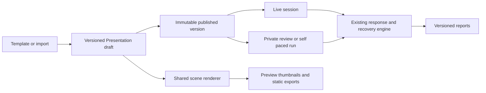

# Polling Pops presentation implementation plan

Planning date: November 3, 2026. Source checkpoint: `f76153d`.

Build a low-priced presentation creator with polished conventional slides, optional audience
activities, flexible navigation and reusable shared content. Broad presentation creation and the
lowest sustainable customer subscription price are the product owner's selected priorities.
Learning and comprehension recovery remain valuable capabilities within that broader product.

The [benchmark](presentation-benchmark-2026-11.md) supplies competitor evidence and customer
scenarios. This plan supplies implementation candidates and acceptance criteria. It authorizes
no deployment, changes no commercial entitlement and does not mark existing evidence gates passed.
The user's broader product direction guides this plan; older learning-only positioning should
not silently narrow its scope.

## Product definition

The first credible broad release must let an ordinary creator make a pitch, project update,
proposal, portfolio or talk without using quiz features. It should also let them add polls,
questions and recovery activities when those help.

The complete workflow is:

1. Start from an original template, blank deck, outline or imported visual slides.
2. Edit text, images, shapes, simple tables/charts and layout with predictable controls.
3. Apply a consistent theme, add notes and preview the audience experience.
4. Present through a private control surface and clean audience display.
5. Optionally run activities with explicit collect, close and reveal controls.
6. Share a private read-only link or static file; later assign genuinely self-paced activities.

Do not force points, correct answers, confidence or educational language into a business deck.
Do not require AI for any ordinary creation, edit or presentation action.

## Delivery strategy and realistic scope

Assumption: one experienced full-time maintainer using Codex, with access to design/customer
feedback and reviewers. Estimates are planning judgments, not measured velocity or commitments.
External evidence collection and production qualification can extend calendar time.

| Milestone                     | Scope                                                                                            | Development estimate              | Exit                                                              |
| ----------------------------- | ------------------------------------------------------------------------------------------------ | --------------------------------- | ----------------------------------------------------------------- |
| Design and compatibility      | E00 scene/renderer prototype, reusable Canvas spike, task fixtures                               | 1–2 weeks                         | Chosen model and bounded editor prototype reviewed                |
| Editable native decks         | E01 scene model, text/images/shapes/connectors, selection, persistence and old-content rendering | 4–7 weeks                         | Create, save, recover, publish and present a native deck          |
| Professional design           | E02 typography, layouts, crop, alignment, grouping/layers, themes and broad templates            | 3–5 weeks                         | Representative creators can prepare a sendable ordinary deck      |
| Information and delivery      | Simple charts/tables, E03 presenter polish and E06 basic reveal/link actions                     | 3–5 weeks                         | Pitch/demo/workshop tasks succeed on desktop and phone            |
| Portability and qualification | E05 visual import, E13 static export, access controls and cross-device hardening                 | 3–5 weeks                         | Imports disclose loss; exports open elsewhere; pilot criteria met |
| Private sharing               | E08 view-only links and mobile review                                                            | 1–2 weeks                         | Recipient-safe viewing and access revocation work                 |
| Broad creator pilot           | All above                                                                                        | **15–26 development weeks total** | Useful creation-to-share workflow; no broad parity claim          |

A 4–6-week vertical slice can demonstrate native creation and live delivery inside the existing
system. It is a progress checkpoint, not the complete broad release. Reserve another 2–4 weeks
after the pilot for observed usability and reliability problems if needed. Do not present the
full Genially/Prezi capability path as a one-quarter solo project.

Expanded responses, full navigation, self-paced delivery, analytics, collaboration, AI and advanced
portability follow as independently selected releases. Their estimates appear below and are
additional to the broad pilot except where explicitly included.

The pilot uses a conventional slide sequence with basic reveals/links. Full section-map navigation,
hotspot dialogs and branching follow in E06/E07; the pilot's product-demo task must be defined
accordingly. If customer testing makes nonlinear navigation a launch requirement, add E07's
2–4 weeks to the selected scope.

## Architecture decision

Use a versioned, bounded Presentation scene. Keep the existing Presentation artifact, draft
revisions, immutable published versions, live-session service, role projections and report jobs.
Reuse pure Canvas geometry, shape and rendering utilities, rather than embedding the Canvas board
application and its workshop lifecycle.

The existing Canvas implementation includes useful text, shape, connector, rotation and layer
primitives in [canvas-content-v4.ts](../packages/contracts/src/canvas-content-v4.ts). Its board
permissions, guest moderation, lifetime limits and transient presenter-follow lease are different
from a deck's publication, navigation and assessment rules. Current Canvas links are private
authoring aids. Any future delivered snapshot requires explicit publication and access rules.



The diagram describes the target, including future review and self-paced runs. It does not imply
that those modes are already implemented.

Proposed scene fields, to settle in E00 rather than copy directly into code:

| Part                | Contract responsibility                                                                                   |
| ------------------- | --------------------------------------------------------------------------------------------------------- |
| Deck                | Schema version, stable slide/section IDs, theme revision, ordered default path and bounded asset manifest |
| Slide               | Fixed stage, ordered nodes, semantic reading order, notes and optional entry/reveal behavior              |
| Node                | Stable ID, finite geometry, layer, type-specific content, accessible name and bounded styling             |
| Initial node types  | Structured text, image/crop, shape, connector, table and inline-data chart                                |
| Action              | Allowlisted reveal, detail dialog, section target or safe external link; explicit activation target       |
| Media               | Private authorized asset reference, type, dimensions, alternative content and lifecycle provenance        |
| Live cursor         | Durable slide/activity reference and phase; server-authorized jump/return commands                        |
| Local view state    | Selection, editor zoom and unsent panel reveals; no authority over live progression or scoring            |
| Independent attempt | Later run/attempt ID, individual cursor, accepted answers, completion and reveal policy                   |

Choose the next schema version after inspecting all current readers/writers. Do not assume that
an apparently unused version number is free: Presentation, Recovery Pack, session and report
schemas have separate compatibility histories. Upcast old content through deterministic adapters;
do not rewrite immutable published rows or change accepted retry fingerprints.

Keep one scene renderer for authoring preview, stage, participant view, thumbnails and export.
Render semantic text and an accessible outline alongside visual geometry. Existing narrow-screen
reading behavior must remain useful; shrinking an entire slide to tiny text is insufficient.

Use the current modular monolith and worker/job infrastructure. Initially, new microservices,
per-view rendering APIs, commercial per-seat canvas SDKs and mandatory model calls would raise
the subscription floor without completing the customer workflow.

## Codex implementation work packages

E00 now has an isolated local implementation; see [ADR 003](decisions/003-presentation-scene.md)
and the [prototype record](evidence/presentation-scene-prototype.md). E01 implementation is complete
locally; release qualification remains open. E02's design foundation and remaining composition,
information and scenario-template software are implemented. E03 delivery, E04 opinion/text formats,
E05 visual import and E06 basic reveal/link interactions are also implemented. E06 advanced
interactions, E07 sections/live navigation and E08 private view-only sharing are merged in
[PR #199](https://github.com/riojung/pollingpops/pull/199). E13 static export is merged in
[PR #200](https://github.com/riojung/pollingpops/pull/200). E09's selected live-session reporting
scope is implemented on `codex/presentation-e09-reporting`. Self-paced attempts and
the remaining later packages stay planned; deployment and release qualification remain open.
Its content-only prerequisite and first native scene persistence/editing/delivery slice are now
implemented locally. The direct-editing increment adds pointer move/resize and temporary
multiselection using the same scene and persistence path. The following rich-text increment adds
bounded emphasis, lists and links through explicit formatting. The completion increment adds visual
slide hiding, valid linked-question filmstrip edits and retained save receipts across retries and
refresh. See the [E01 acceptance record](evidence/presentation-e01-completion.md) for verification
and the human, device and deployment evidence still required.
Use separate branches and PRs for contract/persistence, renderer and UI slices when a package is
too large for coherent review. Dependencies describe technical order; product selection and the
existing rollout gates still apply.

### E00 Establish creator fixtures and the scene decision

Scope: inspect current contracts, rendering, mutation recovery and Canvas primitives. Prototype a
single native slide with editable text, image, shape and connector. Compare a Presentation-owned
scene with a Canvas adapter; record the chosen boundary in a new ADR.

Acceptance: old published decks render unchanged; a prototype can save/reload and produce readable
phone output; keyboard and semantic reading order are demonstrated; node/byte/media limits and
migration strategy are explicit. Record baseline task times and problems rather than inventing
competitor scores. Include a ten-slide pitch, a product demo and a training deck as fixtures.

Current boundary: `/dev/presentation-scene` is available only on the development server and uses
original fixture decks with browser-local saving. Existing production schemas, publication, media,
billing and live behavior remain unchanged. Automated verification is recorded separately from
the still-unmeasured human task timings and assistive-technology evaluation.

Start at: [contracts](../packages/contracts/src/index.ts),
[Canvas content](../packages/contracts/src/canvas-content-v4.ts),
[ContentSlideView](../apps/web/components/presentation/content-slide-view.tsx),
[builder](../apps/web/components/presentation/presentation-builder.tsx),
[Canvas ADR](decisions/002-idea-board-canvas.md). Included in the first milestone.

### E01 Build the native scene and durable editor

Dependencies: E00. Add a versioned scene contract, deterministic legacy adapter and shared renderer.
Implement structured rich text/bullets/links, multiple images, basic shapes/connectors,
selection/multiselection, move/resize, numeric inspector and keyboard equivalents. Add filmstrip
management: new, duplicate, reorder, hide and remove slide. Reuse existing functionality where it
already satisfies the task.

Acceptance: stable IDs survive ordinary edits; duplication remaps internal references; paste is
sanitized; geometry and payloads are bounded; reorder/hide preserves valid assessment/recheck links.
Autosave, Undo/Redo, uncertain retry, refresh recovery and conflict review preserve unsaved work.
Memory and PostgreSQL paths agree. Legacy drafts/published sessions remain readable. Explicit
publish validation freezes the new scene and its asset references.

The first E01 slice now supports content-only publication, session progression/finish and meaningful
participation/timeline reports using existing slides. Empty decks and malformed question/recheck
topology still fail validation. See the [reader and rollback requirements](runbooks/upgrade.md#content-only-presentation-compatibility)
before enabling writers.

The next slice adds opt-in Presentation v4 native slides with bounded plain text, multiple images,
labeled shapes and connectors; numeric/keyboard geometry; semantic reading order; and existing
autosave/undo/recovery/conflict controls. JS/SQL media visitors, publication authorization,
history/version retention and audience projections are integrated. Legacy documents retain their
existing formats. See [native verification](evidence/presentation-native-scenes.md) and the
[version-4 rollout boundary](runbooks/upgrade.md#native-presentation-scene-compatibility).
The following [direct-editing increment](evidence/presentation-direct-editing.md) adds pointer
move/resize, Shift-click and checkbox selection, group movement and safe multi-object deletion.
Gestures preview locally and commit on release; narrow screens retain the readable column and
keyboard/numeric controls. The [rich-text increment](evidence/presentation-rich-text.md) adds
structured paragraphs, bold/italic ranges, bullet/numbered lists and safe web links under opt-in
document v5/scene v2, retaining legacy JSON and hashes.

The completion increment opts hidden visual slides into document v6 without changing the scene
format. Drafts, history and exports retain hidden slides; preview and immutable publication omit
them. Activities cannot be hidden. Reordering cannot move a linked recheck before its source;
deleting a source or copying a recheck produces valid standalone activities. Ordinary save retries
retain and persist the exact mutation envelope before newer edits can be sent. Divergent local
recovery offers preview, download and duplication instead of overwriting the current server copy.
The [acceptance record](evidence/presentation-e01-completion.md) maps E01 to executed checks.
Software completion does not close creator task observations, manual assistive-technology or
physical-device checks, production scanner/storage qualification or deployment gates. Grouping,
themes, charts and reusable components remain E02 scope.

Touch points: current builder/helpers, contracts, `packages/db/src/presentations.ts`,
`apps/server/src/presentation-routes.ts` and media retention. New scene modules are proposed;
extract bounded components rather than growing the existing builder into a second monolith.
Included in the native-deck milestone.

### E02 Deliver design quality and reusable information components

The first E02 increment implements the native design foundation: four bounded color themes,
system font/spacing tokens, five content-preserving layout presets, image contain/cover with a
focal point, selection alignment/distribution and independent visual layer controls. It uses
opt-in scene v3/document v7 and adds no hosted service or paid dependency. See the
[verification record](evidence/presentation-design-foundation.md) and
[reader rollout](runbooks/upgrade.md#native-presentation-design-compatibility).
The completion increment adds transient snap guides, persistent flat groups and proportional
resize, physical 16:9 rotation/connector geometry, bounded editable tables and bar/line/pie charts,
and twelve original eight-slide native scenario decks. The nine facilitated templates remain;
explicit external video plus captions/transcript links fulfill the conditional media scope without
provider embeds. New persisted composition/data uses scene v4/document v8; existing creation and
mutation defaults remain compatible. See the [E02 acceptance record](evidence/presentation-e02-completion.md)
and [composition reader rollout](runbooks/upgrade.md#native-presentation-composition-compatibility).
Software implementation does not close the observed creator, device, accessibility, operating-cost
or deployment qualifications below.

Dependencies: E01. Add theme tokens for fonts/colors/spacing, reusable layout presets, image
crop/fit, alignment/distribution, snap guides, grouping, layer controls and bounded rotation.
Support simple editable tables plus bar/line/pie charts from pasted inline data. Render charts
deterministically; do not add a paid charting service or live spreadsheet sync in this slice.

Create 10–15 original templates spanning pitch, proposal, project update, portfolio, event talk,
product demo, workshop and lesson. A template is a full useful scenario, not a single styled slide.
Keep licensed fonts/assets in the existing asset register. Existing learning templates remain useful.

Acceptance: theme changes do not destroy local content or overflow silently; contrast and fit
feedback are understandable; data charts include a readable table/summary; resize, fonts and media
do not change meaning between preview and presentation. Authors can create a presentable ordinary
deck without adding an activity. Test dark/light themes, 200% zoom, keyboard and narrow screens.

Media scope: images plus, if compatible with the approved CSP/provider policy, explicit
click-to-load video players or clearly labeled external links. Include captions/transcript links,
consent/privacy behavior and visible failure states. Arbitrary iframes and uploaded-video
transcoding are separate E14 work. Included in design/information milestones.

### E03 Improve presenter and audience delivery

The desktop implementation is on `codex/presentation-e03-delivery`: private frozen notes and
next-slide preview, a local elapsed timer, fenced advance shortcuts, persistent join access and a
separate read-only audience stage with popup fallback. Stage credentials use migration 090 and
must not be minted until every server reader enforces the new role. Verification is tracked in
the [delivery evidence](evidence/presentation-e03-delivery.md); observed screen sharing, managed
browser policies, manual accessibility and physical-device qualification remain open. The richer
phone remote remains an optional follow-up to the existing scoped Companion.

Dependencies: E01. Audit and extend the existing host/participant/Companion flow and add a clean
scoped stage. Add clear private notes, next-slide preview, timer, keyboard/clicker actions,
persistent join access and stage preview. A scoped browser phone remote can follow after the
desktop flow works.

Acceptance: host, audience and remote permissions are distinct; joining as a participant never
grants host control; a remote token cannot edit the deck or grant another host. Expiry/revocation,
refresh, disconnect and authorized staff takeover behave predictably. Current Presentation
control-pass creation rotates host credentials; preserve that rule or explicitly design a new
handoff protocol rather than assuming Round cohost roles apply. No backstage notes, hidden correct
answers or moderation controls enter audience projections. Test actual screen sharing and a
managed browser with popup restrictions. Preserve existing idempotent commands and revision fences.

Start with existing live pages, `presentation-companion-routes.ts`, Companion pass helpers and
`presentation-realtime.ts`. Included in the information/delivery milestone; a richer phone remote
is an additional 1–2-week candidate if not required for that milestone's tasks.

### E04 Bring selected Round response formats into Presentations

Dependencies: current live foundations; can proceed independently of most scene editing.
Sequence: multi-select opinion polls and ranking, then moderated open text and word clouds.
Reuse Round semantics without treating a shared question union as surface support.

The first-family software increment on `codex/presentation-e04-opinion-formats` implements
multiple-selection opinion polls and full/top-N rankings in Presentation authoring, independent
Round copies, live delivery, scoped stage/Companion views, and report/CSV evidence. These formats
explicitly opt into document v9; existing document v1–v8 meanings and default creation versions
remain unchanged. Closed-question results are anonymous aggregates, with no participant scoring,
correct answer, confidence or recovery link. Migration 091 and coordinated readers/writers are
required before accepting the new formats. See the [first-family evidence record](evidence/presentation-e04-opinion-formats.md)
and [rollout boundary](runbooks/upgrade.md#presentation-opinion-formats-compatibility).
Automated first-family verification passed; the record preserves executed runs and their limits.
The second family on `codex/presentation-e04-moderated-text` adds document v10 moderated open
text and word clouds, private-body storage, host review, current-block approved results and V5
report/CSV evidence. Together the two families complete E04's software scope. Its
[verification record](evidence/presentation-e04-moderated-text.md) records the repository check,
sixteen real PostgreSQL cases and 48 unique browser cases across documented slices. Software
completion does not establish manual/device, hosted-rollout, cost-target or competitive parity
acceptance. The second-family changes are merged in [PR #196](https://github.com/riojung/pollingpops/pull/196); hosted rollout
remains pending.

Acceptance per format: author, publish, open, submit, acknowledge, reconnect, close, reveal,
moderate where applicable, report and export all work. Never expose pending or removed text in
stage/participant/replay/history projections. Question copies, recovery links, scoring exclusions,
idempotency hashes and old reports remain correct. Opinion questions never acquire a correct
answer accidentally. Run memory/PostgreSQL conformance and a mobile flow for each format.

Start at `presentation-builder.ts`, Presentation contracts, `presentation-session-response-policy.ts`,
session projections, reports and existing Round format implementations. Plan 2–4 weeks per complete
format family; roughly 4–8 weeks for these two families, subject to the moderation scope. Core
existing poll/quiz/Q&A functionality is available earlier; this does not block ordinary deck creation.

### E05 Import visual slides with explicit fidelity

Dependencies: E01 asset model; pair with E13 static delivery. Begin with PDF pages and image sets.
Convert asynchronously into visual slide assets; let users select/reorder pages and insert native
content/activities between them. Google Slides, Canva and PowerPoint users can export PDF first.
Keep the existing source-grounded text/PDF/DOCX/PPTX proposal flow separately named.

Acceptance: show a conversion preview and loss report. Visual slides are labeled as visual rather
than editable objects; animation/media loss is visible. Extracted text requires author review for
reading order and meaning; a page image alone is not an accessible equivalent. Reject encrypted,
malformed, oversized or over-page-limit files with a useful recovery path. Apply timeout, memory,
decompression and total-pixel budgets; isolate parsers/converters from network access. Canceled,
failed and retried jobs do not leave unowned assets or duplicate slides.

Reuse the current quarantine, scan, jobs, private-media and publication lifecycle. Inspect installed
PDF facilities before adding dependencies. Keep original input only under an explicit retention
policy. E05 plus the static part of E13 share the 3–5-week portability milestone. PPTX visual
conversion and editable import are later, separately measured scopes.

The software increment on `codex/presentation-e05-visual-import` implements separate PDF/image
conversion jobs, owned private page assets, preview/loss disclosure, ordered page selection and
author-reviewed visual/reading slide pairs. Existing native content fields preserve historical
document semantics; migration 093 adds job/usage lifecycle records. Conversion requires the
Node 26 runtime's network permission denial and the existing scanned-media facilities, without
an AI provider. E05's PDF/image import software scope is complete: the repository check,
restricted PostgreSQL, four production browser profiles and compiled renderer smoke pass in the
[E05 evidence record](evidence/presentation-e05-visual-import.md). This increment is merged in
[PR #197](https://github.com/riojung/pollingpops/pull/197) and remains undeployed; E13 export and the recorded manual/hosted/cost
acceptance gates remain separate.

### E06 Add accessible interactions and branching

Dependencies: E01. In the broad pilot, implement reveal/hide panels and safe links with reusable
styling. Later add labeled image hotspots, detail dialogs, internal navigation and answer-based
branches. Use a typed allowlist; never store executable scripts or arbitrary HTML actions.

Acceptance: every action has touch and keyboard operation, a visible affordance and semantic order.
Dialogs restore focus. Hidden content cannot leak private data through accessibility markup.
Targets survive duplication/reordering or fail validation clearly. Distinguish local reveals,
host-broadcast reveals and submitted assessments. Local interactions do not change shared scoring
or trigger model calls. Respect reduced motion and provide an outline alternative.

Basic actions are included in the delivery milestone. Richer hotspots/dialogs/branch validation
are an additional 2–4-week candidate. Drag/drop, variables and reusable game mechanics are later
extensions of this model, each requiring a real authoring task and accessible alternative.

The first source increment on `codex/presentation-e06-basic-interactions` implements the planned
local reveal/hide panels and safe-link slice, using scene5/document11 and migration094. Native
authoring/history/design operations preserve actions, and shared delivery offers an equivalent
readable outline without changing responses, scores or host state. The full repository check,
restricted PostgreSQL, focused checks and four production browser profiles pass in the
[E06 basic evidence record](evidence/presentation-e06-basic-interactions.md). This increment merged
in [PR #198](https://github.com/riojung/pollingpops/pull/198) and remains undeployed; richer
hotspots/dialogs/answer branches and host-broadcast reveals are now implemented on
`codex/presentation-interactions-sharing` using document13/scene6 and migration096. This completion
increment adds explicit host-confirmed branches, bounded image anchors, server-withheld broadcast
bodies and ReportV7. Verification and rollout boundaries appear in the
[E06 completion record](evidence/presentation-e06-completion.md). Live section navigation is
implemented separately in E07 below. General scripting, variables and game mechanics remain beyond
the selected E06 scope.

### E07 Add sections and safe nonlinear navigation

Dependencies: E01, E03; uses E06 targets. Add named sections, an overview/map, jump and
return-to-path. The author chooses the default sequence; the host can respond to audience needs.

Acceptance: navigation is a durable command referencing a published slide/activity, not an array
index guessed by a client. Jumping while an activity is open requires an explicit phase-safe
transition. Skipping does not fabricate a completed response; revisiting does not silently reset
attempts, points or reveals. Return restores a defined position. Recheck pairs and reports record
what actually ran. Reconnect/cohost takeover sees the same cursor. Linear and reduced-motion
paths remain equivalent. Estimate: 2–4 additional weeks.

The source increment on `codex/presentation-e07-navigation` adds opt-in document12 named sections,
a private host/Companion map, stable block-ID jump/return commands and durable visited progress.
Numbered block order remains the default path. Detours retain one explicit original anchor;
revisited activities restore their closed phase, original response window and frozen intervention
without new attempts or points. Open activities must close/reveal first, and pending linked
rechecks remain indivisible. Migration095 protects state, frozen targets and exact receipts;
ReportV6 records presented/skipped blocks and navigation events. Validation and remaining release
gates are recorded in the [E07 evidence record](evidence/presentation-e07-navigation.md).

### E08 Share presentations and add self-paced delivery

Dependencies: E01 publication/media; E04 for newly supported question types. Deliver private
view-only links and readable mobile review first. Use a recipient-safe presentation projection;
never publish notes, private moderation data or answer keys by serializing the authoring document.

Then add independent assignment/run/attempt records with individual progression, resume,
deadlines, feedback/reveal policy and explicit completion. Reuse Round practice primitives where
their rules fit; do not add an individual cursor to the host-controlled live snapshot.

Acceptance: links are revocable and scope/retention-bound; authorization is checked for pages and
assets; preview bots do not create learner attempts. Restarts and retries do not double-count
completion. A shared browser does not expose another learner's progress. Offline viewing never
claims an unacknowledged answer was submitted. Content-view completion and demonstrated mastery
are separate. Plan 1–2 weeks for bounded view-only sharing, explicitly included in the broad pilot,
and 4–7 additional weeks for self-paced attempts.

The private review slice is implemented on `codex/presentation-interactions-sharing`; the full
repository pipeline, 70 PostgreSQL cases and eight production-browser workflows pass. Migration097
adds expiring/revocable hash-only capabilities pinned to
immutable versions. The recipient projection excludes private authoring and assessment data;
page transitions and image reads recheck access. Link creation preserves exact uncertain intent
across reload. The [E08 private-sharing record](evidence/presentation-e08-private-sharing.md)
separates this source work from deployment, hosted/device acceptance and the still-planned
self-paced assignment/attempt system.

### E09 Add useful creator and audience reports

Dependencies: existing reports; E08 for review metrics. Report presentation usage, response
coverage, poll distributions, Q&A outcomes and recovery evidence separately. Add a simple
creator-facing view/section-completion report where access policy permits it. CSV/static summary
should be useful without an AI narrative.

Acceptance: define eligible denominators and event freshness; distinguish unique attempts, devices,
sessions and viewers. Omitted/skipped activities are not wrong answers. Dwell time is not labeled
understanding. Aggregation follows current privacy thresholds; deleted or moderated text does not
return through reports or exports. Reports bind to the frozen version and retain historical readers.
Instrument resource cost alongside use. Estimate: 2–4 additional weeks for the selected report scope.

The selected live-session implementation adds a creator **Session insights** panel, formula-safe
CSV and a self-contained readable HTML copy. It combines frozen-version block/section delivery,
exact original-reveal response rosters, opinion distributions, paired recovery and separately
timestamped current public Q&A counts. Missing historical coverage remains unknown; present/skipped
states come from recorded navigation. Samples below five are suppressed, and submitted bodies,
identities, notes and answer keys are excluded. Historical Report V1–V7 and public AggregateSummary
V1 remain unchanged. Bounded counts-only database reads and low-cardinality resource metrics avoid
a model or hosted-service dependency. See the [E09 record](evidence/presentation-e09-session-insights.md).
Private-link view tracking is excluded under the E08 policy. Self-paced attempt/completion
reporting depends on the separate assignment system; this slice does not claim either feature.

### E10 Add spatial storytelling

Dependencies: E01, E06, E07. Arrange sections/frames in a bounded spatial scene and let authors
define an overview and camera path. Reuse Canvas fitting/geometry utilities after E00 extraction.
Preserve the same slides, activities and section IDs rather than introducing an incompatible deck.

Acceptance: spatial and linear paths run the same content and assessments; cameras cannot expose
hidden/private nodes; focus and reading order stay predictable. Bound scene size, node count,
nested frames and animation duration. A phone reader gets meaningful content. Camera movement
remains presentation state, not a Canvas board's temporary follow lease. Estimate: 5–9 additional
weeks for a bounded first spatial mode; unrestricted Prezi parity is a larger ongoing investment.

The first bounded story-map slice is implemented on `codex/presentation-e10-spatial`: explicit
document14 layout opt-in, frame arrangement with existing save/history, publication-safe path
preview and geometry-only live maps. The confirmed block cursor drives camera fitting; current
content and response controls stay readable outside the diagram. View/overview controls are local
to each viewer. The linear block order remains the path, linked rechecks retain their server
guards and Report V7 keeps its existing meaning. Migration098 preserves earlier migration bytes
and extends the existing readers/guards without changing scene6 or default documents.
See the [E10 record](evidence/presentation-e10-spatial.md) for verification. Content-plane camera
rendering, nested frames and facilitator-broadcast overview controls remain later E10 scope;
private review and static exports keep their established linear readers. This slice is merged
in [PR #202](https://github.com/riojung/pollingpops/pull/202) and remains undeployed; unrestricted
Prezi parity remains outside this slice.

### E11 Add review and then concurrent authoring

Dependencies: E01 publication/draft semantics. Start with free read-only reviewers, comments,
resolve/reopen and author approval. Keep current revision conflicts visible. Then introduce
object-level commands with expected versions, operation IDs and actor-owned undo.

Acceptance: view/comment/edit/publish permissions are distinct; an invitation does not silently
allocate a paid creator seat. Revocation fences commands and live delivery. Concurrent edits to
different nodes succeed; same-node conflicts preserve unsaved text and never silently overwrite.
History cannot undo another author's unrelated work or revive removed assets. Published decks and
running sessions remain fixed until an explicit new publication/session choice.

Estimate: 2–3 weeks for review; 6–10 or more for robust concurrent editing. Choose CRDT/operation
technology only after an adapter spike and license review; do not add a paid collaboration
service before cost and merge semantics are understood.

The first review slice is implemented on `codex/presentation-e11-review`: an author explicitly
enables comments on an existing version-pinned private link. Signed-in free reviewers can create
page threads, reply and edit/delete their own messages without joining the source workspace or
receiving a paid seat. Current owner/editor authority governs resolve/reopen and explicit approval
of that link's review; later feedback makes the prior approval stale. Account-bound exact intents,
revision fences, bounded plain text, forced RLS and lifecycle erasure/export protect the sidecar
records in migration099. Existing E08/content/live/report contracts retain their meanings.
See the [E11 record](evidence/presentation-e11-review-feedback.md) for verification. Concurrent
authoring, attachments, mentions and notifications remain later scope. The selected review
slice is implemented on its branch and remains undeployed.

### E12 Extend optional AI assistance

Dependencies: stable native scene, E05 source pipeline and billing quotas. Extend the current
reviewed proposal workflow to outline-to-deck, rewrite/shorten, suggested layout, question
suggestions and translation review. Preserve exact source citations and label unsupported claims.

Acceptance: structured outputs pass normal contracts; generation never publishes or overwrites
approved content automatically. Show resource allowance before a job, cap tokens/concurrency,
deduplicate retries and preserve the deck when the provider fails. Use an approved provider and
existing data policy. No live participant rendering, response scoring or report viewing requires
a model call. Images/audio/video generation are separately priced optional jobs.

Estimate: 2–4 additional weeks for a bounded incremental authoring workflow; unrestricted generated
media and conversational editing of an entire deck require separate evaluation.

### E13 Deliver static export and later richer portability

Dependencies: E01 renderer/assets. In the broad pilot, deliver PDF/PNG of the authorized slide
projection plus an accessible text/HTML view. Reuse existing fonts/rendering utilities where
appropriate. Static exports clearly disclose that activities, motion and live results are flattened.

Acceptance: consistent layout, fonts and image crop across preview/export; bounded page/pixel/byte
and job limits; no private notes/answer keys/credentials; revoked/removed media cannot enter a new
export. An export is a deliberate downloaded copy, not a revocable live link. Do not claim tagged
PDF accessibility until reading order/tags are verified; provide the semantic alternative.

Later: a sandboxed offline interactive package with bundled permitted assets, explicit no-live-
response behavior and no credentials; editable PPTX for a declared text/image/shape/chart subset;
and PPTX import with a compatibility corpus and loss report. E05/static export share the 3–5-week
milestone. Editable PPTX import/export is a separate 6–12-plus-week project after a conversion spike;
perfect round-tripping is not promised. Offline packaging is separately scoped after sharing.

The source on `codex/presentation-e13-static-export` adds whole-deck PDF, selected-page PNG and
self-contained accessible HTML from the safe immutable published projection. The creator chooses
a published version; a separate safe metadata read supplies its page IDs. Current actor/source/
media authorization is rechecked before delivery. Rendering uses existing canvas/PDF/fonts in a
bounded worker, with no new paid service, content version, entitlement or database migration.
PDF/PNG flatten controls and preserve authored frames; HTML includes complete readable text,
tables and public panel details. Limits cover 100 exported pages, 1280×720 visual pages, 40 images,
media/decoded pixels/output bytes, per-actor admission, concurrent jobs and deadlines. The
[E13 evidence record](evidence/presentation-e13-static-export.md) separates automated verification
from manual, hosted, device, usability and cost qualification. Richer portability above remains
separately planned.

### E14 Fund advanced media and ecosystem features

Select extensions from paid customer workflows: hosted audio/video and recording, advanced
animations/games, PowerPoint/Slides add-ins, LMS SCORM/LTI and optional virtual-camera presenting.
The feature path is explicit, but these do not share a credible single estimate or launch date.

Each needs its own discovery and acceptance contract. Uploaded video requires scan/transcode,
captions, player behavior, storage/egress and deletion tests. Add-ins require host-platform
compatibility and managed-device distribution. SCORM/LTI require completion/score/resume and LMS
matrix tests. Virtual camera requires native OS/media engineering. Enterprise controls must
reconcile existing institution/auth policies rather than duplicating them.

Do not bundle unlimited compute-heavy media or extensive integration support into a US$5 base plan
without evidence that its cost is covered. Use a bounded add-on, organization offer or separately
funded milestone when customers require those capabilities.

## Low subscription price and unit economics

Test **US$5 per creator per month billed annually, or US$7 month-to-month**. This is a proposed
price experiment, not an approved price or a market-wide cheapest claim. Basic presentation
creation already has free competitors. Compare the total price of a defined private interactive
creation/presentation bundle in a specified region.

| Offer                    | Proposed customer promise                                                                              | Cost boundary                                                                                                       |
| ------------------------ | ------------------------------------------------------------------------------------------------------ | ------------------------------------------------------------------------------------------------------------------- |
| Free hosted              | Useful private text/image decks, core design, view-only sharing and a small live experience            | Explicit private-storage, deck/history, import/export-job and delivery allowances; existing 20-person cap initially |
| Creator                  | Full core editor, themes/templates, static export, useful interactions and existing paid live capacity | US$60/year or US$7 monthly hypothesis; existing Pro cap 100 initially; bounded media and conversion                 |
| Reviewer/viewer/audience | View or comment within granted scope, and join sessions without buying a seat                          | No editing/publishing authority; host's resource allowances cover use                                               |
| Optional resource packs  | Extra generation, media or occasional-event capacity when qualified                                    | Show price/consumption before purchase; do not make ordinary editing depend on credits                              |
| Community self-hosted    | Existing Apache-2.0 deployment with operator-controlled limits                                         | Hosting, upgrades, backups and support remain the operator's costs                                                  |

Keep creation quality in the lowest paid plan. Avoid per-slide charges and artificial design
restrictions that force a second tool. Publish simple allowance units: stored bytes, accepted
conversion jobs, retained history, transferred media bytes and admitted participants per session.
An active session must not unexpectedly stop because a subscription allowance was crossed.
Enforce admission/reservation before work begins; never erase content on downgrade.

Current entitlements are 20 Free and 100 Pro participants subject to the operator cap, with staged
feature policies. These are code limits, not measured capacity. Do not raise them to match Genially
without qualification. Adding free reviewers and a new Creator price requires a deliberate role,
billing and entitlement migration; the table above does not change today's plan names or behavior.
See [entitlements](../apps/server/src/entitlements.ts) and
[business management](business-management.md).

Use this monthly model before choosing allowances:

```text
contribution per paying creator =
  recognized subscription revenue excluding collected taxes
  - payment/refund allowance
  - creator's storage, delivery, jobs, AI and live-session cost
  - active free users × cost per active free user / paying creators
  - attributable support and abuse handling

operating surplus = paying creators × contribution per creator
                    - shared infrastructure - other fixed operating cost
```

Illustrative USD assumptions only, not provider quotes or measured Polling Pops costs:

| Input at 100 paying creators and 500 active free users                | Base case per paid creator/month | Stress case |
| --------------------------------------------------------------------- | -------------------------------: | ----------: |
| Recognized annual-plan revenue                                        |                            $5.00 |       $5.00 |
| Payment/refund allowance                                              |                            $0.25 |       $0.25 |
| Direct resource cost                                                  |                            $0.60 |       $2.50 |
| Free subsidy, $0.10 or $0.30 per active free user                     |                            $0.50 |       $1.50 |
| Support/abuse allowance                                               |                            $0.40 |       $0.75 |
| Contribution                                                          |                        **$3.25** |   **$0.00** |
| Shared infrastructure assumption, $120/month across 100 paid creators |                            $1.20 |       $1.20 |
| Remaining before other fixed costs/tax/labor                          |                        **$2.05** |  **−$1.20** |

At only ten paid creators with the same 5:1 free-to-paid activity ratio, the $120 shared cost alone
is $12 each: this price cannot cover the business. Annual cash collection is not immediate earned
profit; service obligations continue throughout the year. Keep founder development labor and
marketing costs visible outside this contribution model. Recalculate using actual invoices,
payment terms, retention, conversion and customer usage.

Proposed commercial gate: positive stressed contribution and a base contribution margin of at
least 60% before shared fixed costs, plus a credible paid-customer count to cover fixed cost.
If the gate fails, first bound expensive media/jobs, reduce waste or offer explicit resource packs;
then reconsider price. Do not publish a loss-making unlimited promise to win a comparison table.

## Keep operating cost close to static content

Thirty image slides at 0.2 MB each, fetched once by 100 viewers, transfer about **0.6 GB per session**
before thumbnails, retries and other data; 250 viewers would be 1.5 GB. This is sizing arithmetic,
not a measured workload. Video can dominate it. Measure distribution tails, not only the mean.

Recommended controls:

- Store scene JSON separately from assets; content-address thumbnails/exports by revision and
  access scope. Deduplication must not expose whether another tenant owns an asset.
- Reuse authenticated media delivery and scanning. Do not make private assets public to gain CDN
  caching. Any future CDN path needs explicit authorization, expiry and revocation behavior; the
  current deployment guide uses DNS-only ingress.
- Compress images and fetch the current/next slide rather than preloading every full-resolution
  asset on every phone. Bound total assets and page pixels before conversion.
- Keep edit selection, pointer movement and local reveals in the browser. Send committed edits and
  required live deltas; do not broadcast every mouse move or full deck on each response.
- Reuse current response coalescing, role projections and durable acknowledgement. Keep report
  generation deterministic and run expensive exports/conversions through bounded jobs.
- Record per-job CPU/time/output bytes, media delivery, retained bytes, live participant-minutes,
  retries and optional model cost. Use sampled aggregate operational records without storing raw
  learner answers in cost telemetry.
- Reserve quotas before expensive jobs; release reservations on safe cancellation/failure; enforce
  atomic reservations across multiple workers. Preserve publication/media references during cleanup.

These are proposed controls, not claims that a CDN, all resource meters or all new job limits
already exist. Use the existing single-VM topology until measured load justifies a change.

## Customer validation and release criteria

Recruit a small broad-creator pilot covering business decks, interactive demos, independent shared
content and learning/event delivery. Use the same tasks and fixture corpus as the benchmark.
Record existing alternatives, actual repair effort and willingness to pay US$60/year rather than
assuming a lower price creates demand.

Proposed pilot targets, to freeze before running the study:

| Outcome       | Proposed criterion                                                                                                                                                  |
| ------------- | ------------------------------------------------------------------------------------------------------------------------------------------------------------------- |
| Creation      | At least 80% of eligible first-time creators complete their assigned ordinary deck task without facilitator rescue; report failures by segment                      |
| Reuse         | Visual import plus two activity insertions takes a median ≤10 minutes for the defined twenty-slide fixture; report inaccessible/lost content separately             |
| Delivery      | No lost acknowledged responses or duplicate scoring in the reconnect/retry corpus; all staff-only projection checks pass                                            |
| Accessibility | Core tasks work by keyboard and tested screen reader; semantic reading order, focus, 200% zoom and reduced-motion alternatives verified                             |
| Performance   | Provisional p95 accepted-command propagation ≤1 second and response acknowledgement ≤1 second at current admitted capacity under a specified region/network profile |
| Cost          | Measured base/stress usage supports the commercial gate and proposed allowances; show free subsidy and high-usage creators separately                               |
| Value         | Record completed second-use workflows and actual paid-pilot choices; avoid inferring willingness to pay from positive feedback                                      |

These are new product targets, not passed gates or substitutes for existing requirements. Set
the task sample, eligible denominator, timing start/end, exclusions and network conditions in
advance. Where another repository gate is stricter, preserve it. User research may change order
and scope; production promotion still follows the release ledger, security/accessibility review,
device/media checks, backup/restore and capacity evidence.

Existing references: [research campaign](runbooks/phase0-evidence-campaign.md),
[release ledger](release-readiness.json), [implementation status](implementation-status.md),
[earlier backlog](competitor-backlog-2026-10-27.md). Retain historical learning evidence separately
from newly collected broad-creator evidence. Market research alone cannot close either.

## Test strategy for implementation

Test behavior at the layer that owns it. A new node needs contract/upcast and rendering coverage;
a new response type needs durable repository, server-projection and report coverage; a new share
mode needs access/revocation coverage. Reuse existing tests and add meaningful regression cases.

| Change               | Required evidence                                                                                                       |
| -------------------- | ----------------------------------------------------------------------------------------------------------------------- |
| Scene schema         | Legacy fixture compatibility, malformed/bounded input, ID/reference remapping, immutable publish and retry fingerprints |
| Editor               | Save/reload, keyboard/touch selection, undo/conflict recovery, fit/reading order and representative visual fixtures     |
| Media/import/export  | Actual parser/scan/private-byte flow, quota failures, cancellation/retry, lifecycle cleanup and opened output files     |
| Live/navigation      | Memory/PostgreSQL agreement, multi-writer retry/reconnect, phase fences, role projections and cohost takeover           |
| Interactions/reports | Reveal policy, moderation/deletion, meaningful denominator and frozen-version binding                                   |
| Sharing/coediting    | Cross-tenant denial, invited roles, revoked access, same-node conflict and actor-owned undo                             |
| Pricing/resources    | Reservation races, downgrade, over-limit admission and existing billing reconciliation                                  |

Useful existing tests include `packages/contracts/test/presentation-contracts.test.ts`,
`packages/db/test/support/presentation-session-conformance.ts`,
`apps/server/test/presentation-session-api.test.ts`,
`apps/web/components/presentation/presentation-builder.test.tsx`,
`tests/beta-e2e/presentation-layout.spec.ts` and the Q&A/Companion browser suites.

Example targeted commands, to adapt to the actual slice:

```sh
pnpm --filter @openround/contracts test
pnpm --filter @openround/db test
pnpm --filter @openround/db test:postgres
pnpm --filter @openround/server test -- test/presentation-api.test.ts test/presentation-session-api.test.ts
pnpm --filter @openround/web test -- components/presentation/presentation-builder.test.tsx
pnpm exec playwright test --config=playwright.beta.config.ts tests/beta-e2e/presentation-layout.spec.ts
pnpm load:presentation:compose
pnpm check
```

Use a configured isolated environment for browser, PostgreSQL and Compose/load tests. PostgreSQL
coverage requires both `TEST_DATABASE_ADMIN_URL` and `TEST_DATABASE_URL`; a run with skipped cases
does not establish database conformance. The existing `pnpm test:multi-writer` also requires
`TEST_REDIS_URL` and exercises Round sessions, so new Presentation scene/navigation concurrency
must have Presentation-specific cases. A harness
supporting up to 250 simulated clients is not proof of supported customer capacity. Run relevant
targeted tests while developing and the repository-required checks before merge; do not repeat
unrelated suites after documentation-only changes. Web code work must follow `apps/web/AGENTS.md`,
including consulting the installed Next.js documentation before changing frontend behavior.

## Working with Codex

Start each task from the current source, not this checkpoint's assumptions. Use a `codex/` branch,
keep unrelated user edits, and read applicable `AGENTS.md`. Give Codex one complete behavioral
slice with explicit exclusions, compatibility cases and a definition of done.

Copyable first task:

```text
Implement E00 from docs/presentation-implementation-plan-2026-11.md.
Target broad presentation creation and a low subscription price.
Inspect current Presentation contracts, shared renderer, autosave/recovery,
publish/live/media pipelines and reusable Canvas primitives.
Build a bounded local prototype with text, an image, a shape and connector,
plus semantic reading order and keyboard editing. Keep it off the public path.
Write an ADR comparing a Presentation-owned scene with a Canvas adapter.
Specify schema compatibility, asset/publication rules, bounds, proposed modules
and the first E01 vertical slice. Verify old fixtures and save/reload behavior.
Do not change billing, production flags, workshop semantics or deploy anything.
Report changed files, observed limitations and targeted validation.
```

Copyable implementation task after the ADR:

```text
Implement only the selected E01 vertical slice from the approved scene ADR:
create/edit/save/reload/publish/present text + image + basic shape slides.
Reuse current revisions, operation IDs, media authorization and publication.
Add deterministic legacy adapters and preserve accepted retry fingerprints.
Provide keyboard/semantic reading order and responsive audience rendering.
Cover contracts, persistence, renderer and one end-to-end creator workflow.
Keep unsupported node types and existing rollout flags closed.
Do not add AI, coediting, video conversion, PPTX fidelity or new services.
Run targeted tests and required repository checks; prepare a reviewable PR.
```

For each PR, require a creator-visible result, legacy compatibility evidence, failure/retry behavior,
accessibility verification and any operating-cost change. Update user-facing guidance and status
only for what that PR actually implements. The next task should follow the measured bottleneck,
while preserving the explicit path to interactions, spatial navigation, independent viewing,
collaboration and portability described here.
