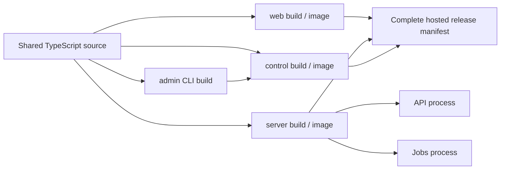

# Component builds and compiler recovery

Build the component you are changing during development, then run the full verification pipeline
before a release. Polling Pops remains a modular monolith with shared source packages and a
single-VM hosting option. These build boundaries reduce unnecessary compilation and preserve
simple operations; they do not require additional paid services or a microservice migration.

Use the [deployment runbook](deployment.md) for service control, hosted target configuration,
signing, promotion, and rollback. This runbook covers build scope and compiler outputs.

## Build and runtime units

| Unit             | Responsibility                                                                       | Host build and output                                                        | Image / runtime boundary                                                             |
| ---------------- | ------------------------------------------------------------------------------------ | ---------------------------------------------------------------------------- | ------------------------------------------------------------------------------------ |
| Customer web     | Creator, host, presenter, participant, and customer workspace UI                     | `pnpm build:web` → `apps/web/.next`                                          | `web` image, Next standalone server                                                  |
| Server           | REST API, realtime authority, authorization, migrations, and background work         | `pnpm build:server` → `apps/server/dist`                                     | One `server` image; API and jobs run as separate processes                           |
| Operator control | Platform administration UI                                                           | `pnpm build:control` → `apps/control/.next`                                  | `control` image, Next standalone server                                              |
| Admin CLI        | Operator setup and administration commands                                           | `pnpm build:admin` (also `pnpm admin:build`) → `apps/control/admin-dist`     | Included in the control image as `/app/admin-cli.mjs`; no separate service           |
| Shared packages  | Contracts, database repositories, domain logic, experiences, and control-plane logic | Optional `pnpm build:packages` → package `dist` directories and declarations | Application compilers consume package TypeScript source; no package service or image |



The control image is part of hosted releases that use the business control overlay. API and jobs
share a server image and release identity even though their process entry points and resource
needs differ. The current topology can allocate capacity to those processes without splitting
the source tree into independently deployed services.

## Host builds

Use the supported Node.js version from `package.json` and install the pinned dependencies first:

```bash
corepack enable
pnpm install --frozen-lockfile
```

Choose a build scope from the repository root:

```bash
pnpm build:web
pnpm build:server
pnpm build:control
pnpm build:admin
```

`pnpm build` builds all application artifacts, including the admin CLI, with bounded Turbo
concurrency. It does not first build declarations for every shared package. Package exports point
at source, so the consuming Next or tsup compiler includes the source it needs. Use
`pnpm build:packages` only when inspecting or validating the shared package bundles and `.d.ts`
outputs themselves.

The scoped commands compile artifacts; they do not run the full checks or restart services. Run
`pnpm check` for formatting, Docker-context validation, lint, full type checks, tests, and all
application builds. For database and server integration suites, provision isolated test services
and export `TEST_DATABASE_ADMIN_URL`, `TEST_DATABASE_URL`, and `TEST_REDIS_URL`, then run:

```bash
pnpm test:integration
```

The integration command fails immediately if one of those variables is absent. Turbo disables
caching for database and server test tasks and explicitly passes these variables through, so a
prior test result cannot replace a run against the selected test services. Keep credentials in
the test environment rather than build documentation or committed files.

## Development images

Build only the image needed for a local change:

```bash
pnpm product:build development --component web
pnpm product:build development --component server
pnpm product:build development --component control
```

Omit `--component` to build all three application images:

```bash
pnpm product:build development
```

The server selection includes the API and jobs artifact set. The control selection also builds
the admin CLI. `--component api`, `--component jobs`, and a separate CLI image are unsupported.
These commands build images without starting or restarting containers. Use the profile-aware
service commands in the [deployment runbook](deployment.md#operate-services) when ready to run
them.

Image builds validate the Docker workspace dependency closure and compile inside each Docker
build stage. They do not run `pnpm build` on the host first. Running a host build immediately
before an image build is optional local validation, not a prerequisite or a source of image
artifacts.

## Hosted release boundary

`--component` is development-only. Staging and production still require a clean worktree at an
exact full Git SHA and a complete release manifest: server and web, plus control when selected by
the reviewed hosted topology. The build records immutable image digests, source identity,
platform, and the public API origin. Existing signature, vulnerability scan, provenance, target,
readiness, and promotion requirements continue to apply.

Use the protected workflows and commands in the
[deployment runbook](deployment.md#build-product-images). Do not assemble a new hosted manifest
by keeping an old web, server, or control image from another release. The shared contracts,
database migrations, generated reports, and stored content readers currently rely on a reviewed
release set. A successful scoped build alone does not establish compatibility between arbitrary
image versions or make a schema rollback safe.

Independent hosted component rollouts are future work. They need explicit versioned compatibility
rules for APIs, realtime protocols, stored content and schemas, expand/contract migrations,
mixed-version tests, and a rollback policy. Keeping complete hosted releases now preserves a
straightforward and lower-cost operational model while allowing scoped development builds.

## Cache and type-check contracts

- Turbo uses dependency `transit` tasks to propagate shared source changes into dependent task
  hashes without generating unused package declarations first. Build inputs exclude tests and
  generated Next directories; full typecheck and test tasks retain their own broader inputs.
  This follows the [Turbo transit-node pattern](https://turborepo.dev/docs/crafting-your-repository/configuring-tasks#dependent-tasks-that-can-be-run-in-parallel).
- Web and control builds always enter the guarded Next compiler. Their Turbo artifact caching is
  disabled so a restored output cannot bypass output locks or variant checks. Next owns compiler
  cache invalidation within each output directory. CI persists only the corresponding `cache`
  directory with separate keys for product, core-browser, and beta-browser roles, including the
  runner, Node version, lockfile, and build configuration. See
  [Next CI build caching](https://nextjs.org/docs/app/guides/ci-build-caching).
- The production Next profiles extend the strict application TypeScript settings and include
  runtime source plus the selected output's generated route types. They exclude test files from
  production compilation. TypeScript errors still fail the build; `ignoreBuildErrors` is not
  enabled. `pnpm typecheck` uses the full application configurations, including tests, and checks
  the other workspaces too. The server and CLI tsup builds still require that separate typecheck
  gate. See [Next TypeScript configuration](https://nextjs.org/docs/app/api-reference/config/next-config-js/typescript#tsconfigpath).
- Dockerfiles copy package manifests before source, retain locked pnpm download caches per image,
  and copy only the component's workspace dependency closure. Web and control also mount their
  separate `.next/cache` directories through BuildKit, with component/Node-specific cache IDs and
  locked sharing. A changed source file can reuse dependency installation layers and compiler
  caches; a changed required manifest or lockfile invalidates the install layer. The dependency
  checker guards against missing transitive packages and recognizes mounted build instructions.
  BuildKit caches are optional accelerators, not release artifacts. See
  [Docker cache optimization](https://docs.docker.com/build/cache/optimize/).

Do not copy `.next` artifacts between product and browser roles or treat a compiler cache as a
ready-to-serve build. Source changes still require compilation and validation.

## Production browser test builds

Ordinary `pnpm test:e2e` and `pnpm test:e2e:beta` use their dedicated development outputs. To test
the production standalone web build, prepare the matching role once, then reuse it across suite
invocations:

```bash
node scripts/build/browser.mjs build core
PLAYWRIGHT_PRODUCTION=true PLAYWRIGHT_REUSE_BUILD=true pnpm test:e2e --project=chromium
```

```bash
node scripts/build/browser.mjs build beta
PLAYWRIGHT_PRODUCTION=true PLAYWRIGHT_REUSE_BUILD=true pnpm test:e2e:beta --project=chromium-beta
```

The outputs are `apps/web/.next-browser-core` and `apps/web/.next-browser-beta`; product output
remains `apps/web/.next`. Core uses web/API ports `3100`/`4100`; beta uses `3200`/`4200` by default.
For custom beta ports, pass the same `WEB_PORT API_PORT` pair to the preparation helper and set
`BETA_E2E_WEB_PORT` / `BETA_E2E_API_PORT` for Playwright. Build and start must agree on the API
origin because `NEXT_PUBLIC_API_URL` is compiled into the browser bundle.

`PLAYWRIGHT_REUSE_BUILD=true` reuses the compiled web artifact, while each Playwright invocation
starts fresh web and API processes. Both configs set `reuseExistingServer: false`; do not retain a
fixture API between phases. API feature flags and isolated synthetic providers can change between
phases without repeating the web compilation, provided the compiled web inputs still match.
Without `PLAYWRIGHT_REUSE_BUILD=true`, a production test start prepares the build itself.

Both configs give the web helper a graceful SIGTERM shutdown window of ten seconds. This lets its
signal handler terminate and await the detached Next process group before releasing the output
lock. Keep that setting when adding test phases: forcibly killing only the wrapper can orphan a
Next process and leave teardown hanging or its output locked.

Preparation preserves the role's compiler `cache` while replacing its other generated output.
It records schema-2 `browser-build.json` metadata with the role, output directory, Node version,
API origin, source digest, and build-environment digest. The source digest includes actual
working-tree contents, including uncommitted/new source and local application environment files.
The artifact digest covers the build ID and complete standalone runtime, including compiled
routes, chunks, manifests, dependencies, and copied public/static assets. Traced pnpm symbolic
links must resolve inside that packaged runtime; broken or escaping links fail validation.
Start validates both provenance and runtime contents; a mismatch fails with an instruction to
rebuild the role. Rebuild after changing source, build configuration, Node, public build variables,
or the API origin. A matching commit ID alone is insufficient.

CI prepares each core/beta artifact once per browser matrix job and reuses beta output across
fresh API phases. This reduces the configured default CI web compilations from 21 to 9; it is a
workflow count for the all-pass path, not a measured wall-time or cost claim. The
[qualification record](../evidence/component-build-pipeline.md#qualification) covers the passing
full check and selected production browser cases, along with the unavailable Docker image
validation and known baseline beta product failures.

## Compiler progress, deadlines, and locks

The web and control build entry points use `scripts/build/next.mjs`. It reports compiler output
and a heartbeat every 15 seconds with elapsed time, the last observed phase, and compiler PID.
The default compilation deadline is 10 minutes. Override the budgets for a known environment
when needed:

```bash
OPENROUND_BUILD_TIMEOUT_MS=900000 OPENROUND_BUILD_HEARTBEAT_MS=15000 pnpm build:web
```

These controls apply to guarded Next builds, not every subprocess in the repository. A deadline
or cancellation through SIGINT, SIGTERM or a terminal SIGHUP terminates the owned compiler process
group, escalates if needed, and completes cleanup before releasing locks. SIGHUP exits with status
129 after restoring generated configuration and releasing both leases. Inspect the compiler log
and its reported phase when a build fails; a heartbeat proves the wrapper is alive, not that
compilation is making progress.

Locks live in `.turbo/build-locks`. Each app has a compiler lock because Next can update shared
generated configuration, and each app/output pair has an output lock. Browser servers keep their
output lock for their entire lifetime, preventing another build from rewriting the served output.
Different output roles remain separate. The wrapper restores `next-env.d.ts` and the production
tsconfig after compilation so generated changes do not silently alter the source worktree.

If a command reports `Compiler output is busy`, inspect the named lock and its owner:

```bash
cat .turbo/build-locks/web-compiler.json
ps -p 12345 -o pid,ppid,etime,command
```

Use the exact lock path from the error; the example is only the web compiler lock. Check the
recorded hostname, replace `12345` with its owner PID, and inspect the related build/server process
tree. Stop an active owner through its normal terminal or process manager and wait for cleanup.
If the owner has exited and inspection confirms that no build or server owns that output,
manually remove only the identified stale lock, then retry. An unreadable lock or a PID missing
on a different host does not establish that it is stale. There is no automatic unlock or blanket
lock-deletion command: deleting a live owner's lock permits concurrent writes and can corrupt
served output.
