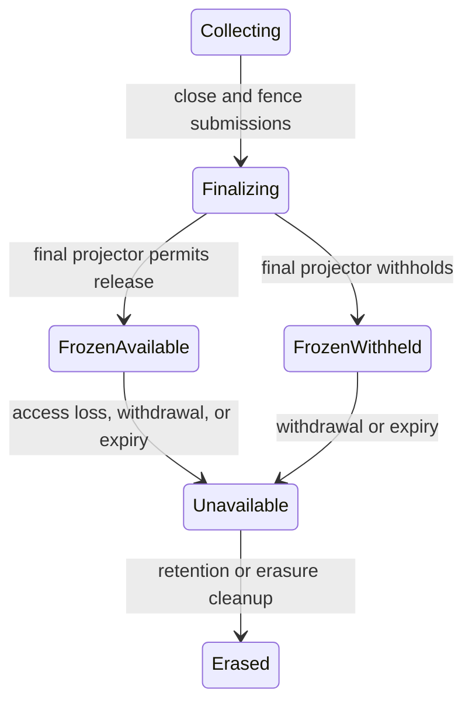

# Conditional Survey C2: whole-report disclosure controls

Baseline: merged C1, [PR #289](https://github.com/riojung/pollingpops/pull/289), `01df23d`.
Branch: `codex/survey-branching-privacy-policy`.
Merged through [PR #290](https://github.com/riojung/pollingpops/pull/290) at `d6f3fd3`.
The owner selected **withhold the whole report until privacy checks pass** on November 19, 2026.

C2 implements an isolated candidate disclosure policy and automated qualification fixtures. It
does not expose a live report, change collection permissions, or establish production privacy
acceptance. C3 must enforce the lifecycle below; C4 must apply it to summaries and exports before
B3 enables conditional authoring. Existing v1–3 Surveys and aggregate-v2 remain unchanged.

## Policy and version boundaries

The separate contracts subpath `@openround/contracts/survey-branching-results` adds
`surveyBranchingDisclosureResults(content, submissions, closed=false)` and
`SurveyBranchingDisclosureResultsSchema`. The proposed result has **aggregate schema version 4**,
**source content version 4**, and the fixed policy identifier `joint_contribution_atoms_v1`.
Those version numbers describe independent contracts. C1 aggregate-v3 remains a separate,
suppressed-only schema and projector; it never becomes an available-result variant implicitly.

Published v4 content and strict `{ finalized: true, responses: ... }` wrappers use the same
canonical input boundary as C1. Each response map is normalized once, validated against the
frozen Survey, and then used unchanged for both policy evaluation and aggregate counts. Invalid
or hidden answers reject the entire batch with payload-free errors; no reconciliation, partial
counting or answer-value deduplication occurs. A future repository adapter must select authoritative
finalized submissions once per guest. The wrapper alone proves neither finalization nor identity.

## Joint contribution groups

For each valid finalized submission, construct one private vector in frozen question order:

1. Mark each question logic-skipped, eligible-unanswered, or answered.
2. For an answered poll, include its full selection set using the authored choice identities/order.
3. For an answered rating, include its exact rating bucket.

All values affecting any released count are represented. Labels do not identify groups: equal
choice labels must not collapse distinct choices, and multi-selection combinations must remain
distinct. Identical vectors form a **joint contribution group** (an atom). Identical submissions
from different guests are counted separately. Grouping considers observed vectors only; it does
not enumerate every possible response combination.

The whole report is available only when collection is closed, there are at least five finalized
submissions, and **every nonempty observed atom contains at least five submissions**. Otherwise
all evidence is withheld, including the global submission total. Callers cannot lower the minimum,
omit questions, select a cohort, merge rare groups, round results, or supply an approval override.

| Example                                                                                 | Outcome under C2                                               |
| --------------------------------------------------------------------------------------- | -------------------------------------------------------------- |
| No submissions or four identical submissions                                            | Whole report withheld                                          |
| Five identical valid submissions                                                        | Available after closure                                        |
| Two distinct full patterns with counts 5 and 5                                          | Available after closure                                        |
| Two patterns with counts 5 and 4                                                        | Whole report withheld                                          |
| Nested cohorts N=15, parent=10, child=9                                                 | Withheld: the ancestor-only pattern has one submission         |
| Two controllers with joint counts `[9,1,1,4]`                                           | Withheld despite otherwise large marginal samples              |
| The same controllers with joint counts `[5,5,5,0]`                                      | Available; its marginal counts can equal the preceding example |
| Adequate branch membership split by a rare rating/optional-answer/selection-set pattern | Whole report withheld                                          |

## What the check establishes—and its limits

Every cohort expressible as a Boolean combination of these fixed contribution predicates is a
union of whole observed atoms. If all atoms pass, such a cohort has size zero or at least five.
This covers nested subsets, complements and overlaps over those predicates in **one evaluated
dataset**. It is not a claim about every arithmetic operation on reported numbers: disjoint groups
of size five and six can have a numerical difference of one without a one-submission subset.

This is a conservative repository-defined disclosure control, not differential privacy,
verified-person anonymity, a formal security certification, or protection against arbitrary
external knowledge. It has important limits:

- Many questions, rating buckets, optional omissions and multi-select combinations can make
  full patterns rare. A large Survey can therefore remain entirely withheld. C2 does not weaken
  the policy silently to improve report availability.
- A homogeneous released group can reveal shared answers to someone who already knows its
  membership. Account-free submissions do not establish five distinct people.
- The available/withheld outcome is itself data-dependent. With four known identical submissions
  and a target submission, that outcome changes according to whether the target matches the
  known pattern. Tests retain this counterexample as a limitation, not a successful privacy claim.
- Releasing multiple snapshots or related outside datasets can defeat the bounded single-dataset
  reasoning. A pure function cannot enforce one-time publication, erasure or operator behavior.

Human privacy acceptance and an explicit deployment threat model remain open. Risk assessment
must consider the whole release process, as described by
[NIST SP 800-188](https://csrc.nist.gov/pubs/sp/800/188/final). Formal differential-privacy claims
require a different kind of guarantee; [NIST SP 800-226](https://www.nist.gov/publications/guidelines-evaluating-differential-privacy-guarantees)
provides evaluation guidance. Neither source endorses the threshold or certifies this implementation.

## Public shape and denominator semantics

The proposed result has only three states:

| State              | Evidence                                                                            |
| ------------------ | ----------------------------------------------------------------------------------- |
| `collecting`       | `submittedCount: null`; every question count null and distribution empty            |
| `privacy_withheld` | The same whole-report withholding, without the failing group or reason              |
| `available`        | Exact total, all questions unsuppressed, exact counts and complete authored buckets |

No atom vector, atom count/size, failed question, private diagnostic, response map or per-person
trace may appear in the DTO. Strict objects reject unknown fields and mixed suppression.
Available counts are safe nonnegative integers; every positive released cohort/bucket count meets
five. The schema checks E=A+U and N=E+S, bucket bounds and poll/rating totals. Multiple-selection
bucket sums can exceed the answered count, bounded by that count times the selection limit.

These structural checks are necessary but **cannot certify joint qualification**. The examples
`[9,1,1,4]` and `[5,5,5,0]` can produce identical aggregate marginals. A DTO parser cannot know
which underlying population produced them. Only the projector over authoritative frozen inputs
can evaluate the policy; accepting arbitrary caller-supplied aggregate JSON is not approval.

Counts mean finalized submissions, not verified unique people. Coverage uses answered/eligible;
distribution percentages use bucket/answered. An unvisited branch has exact zero eligible,
answered and unanswered counts in an otherwise available report. Coverage is undefined when
eligible=0. If eligible>0 but answered=0, coverage is 0%; distribution percentages remain undefined.
Readers must preserve these distinctions rather than substituting 0% for an undefined denominator.

## Required C3/C4 publication protocol

The following is a design requirement, not a storage implementation delivered by C2:

1. Serialize finalization against guest admissions and response writes. A queued request with an
   older timestamp must not slip into a different population after the outcome is captured.
2. Select each authoritative finalized guest exactly once under the current workspace/RLS and
   frozen-content authority. Incomplete attempts and previews are excluded.
3. Atomically persist **one final outcome per run**, including withheld outcomes. Bind its source
   publication, policy version and aggregate version. Uniqueness is by run, not by policy version;
   changing a policy must not create another differently composed release for the same run.
4. Reads, refreshes, shares and PDF/PNG/XLSX exports consume that exact stored result. Do not
   recompute from rows or add filters/selected-question views. Content-reader version 4 is not
   automatically aggregate-reader version 4; negotiate results compatibility independently.
5. Recheck current access, source lifecycle, retention and token revocation. Access loss masks
   the stored result for that reader; it does not authorize a new snapshot.
6. If erasure invalidates the underlying population, withdraw the whole snapshot and dependent
   shared/downloadable artifacts. Do not publish reduced totals or regenerate a withheld result.
   Account/room erasure and expiry must cascade under the established lifecycle. Previously
   downloaded files cannot be recalled by revoking a link.

Current conditional result endpoints and summary/export gates remain unchanged and unavailable.
C2 does not add a table, migration, runtime caller, writer grant or new participant identity.

## Local verification, November 19, 2026

`VITEST_MAX_WORKERS=1 pnpm check` passed formatting, Docker workspace dependency checks,
repository lint/type checks, all active tests, four application build tasks and compiled-server
startup. The suites include 1,140 contract, 6,406 web, 1,672 server, 666 default database and
529 support tests. Configured optional integration skips remain.

The 31 new C2 cases cover the projector, strict DTO arithmetic and adversarial privacy limits.
The privacy reference checks enumerate 625 joint histograms and all Boolean unions for 80
qualified populations. All 87 focused C1/C2/legacy contract cases and 14 existing API/summary
boundary cases passed. The separate `@openround/contracts` build emitted the existing subpath's
JavaScript and declarations with the additive C2 exports.

Independent read-only review found no actionable issue. These automated checks qualify the
isolated implementation; they do not grant human privacy acceptance or enable runtime reports.
